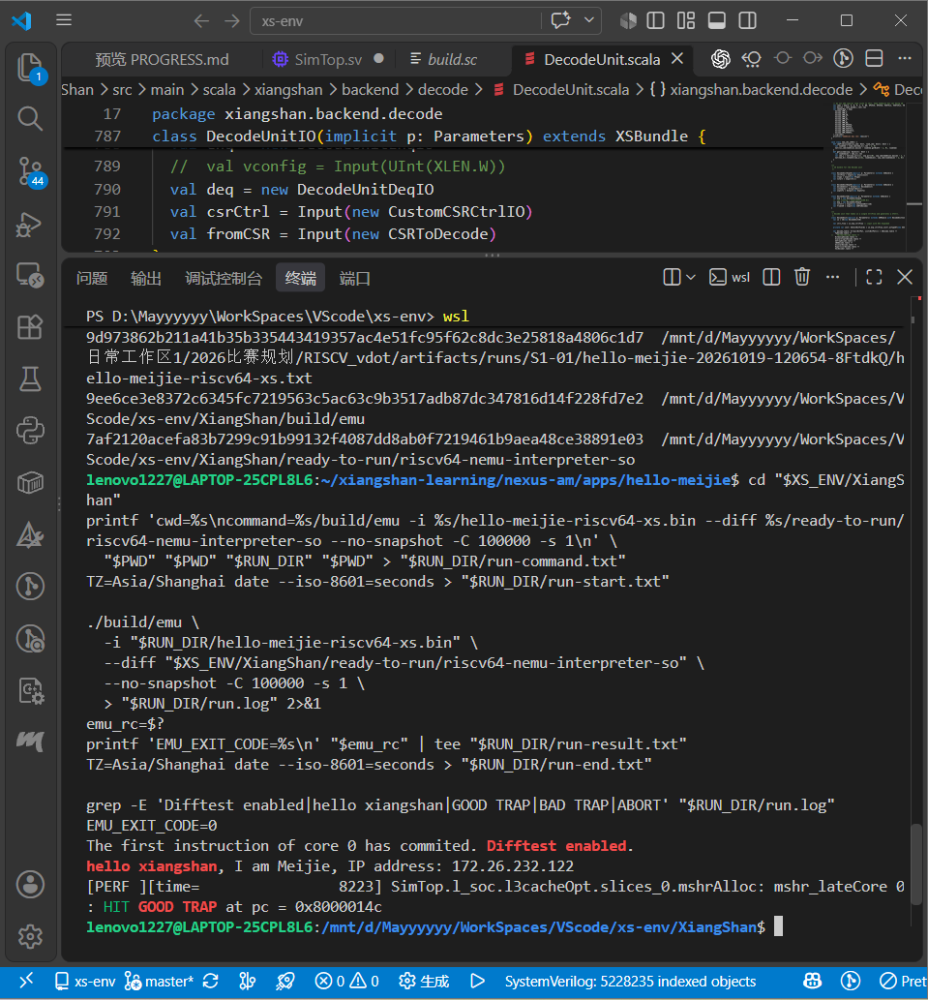

# 2 环境部署与运行验证

后续指令开发需要两种能力：运行真实 RISC-V 程序，并能观察程序在香山整核中的执行过程。第一阶段因此先把源码构建、应用编译、镜像加载和差分检查串成可复现流程，再用定制 Hello 与四元素向量加法确认运行环境。Hello 检查基本启动和输出通路；VADD 则提供可手算的向量结果，并成为下一章波形追踪的对象。

## 2.1 实验平台与仿真流程

实验在 Windows 11 的 WSL2 Ubuntu 环境中开展，香山使用昆明湖 V2 代码线和单核 MinimalConfig。这里记录的是 2026-10-19 基础环境验收所使用的版本；第三阶段扩展指令时使用的源码 NEMU 另行登记。

表 2-1　基础环境配置。

| 项目 | 本次实验配置 |
| --- | --- |
| Linux 环境 | WSL2，Ubuntu 24.04.4 LTS |
| 可用资源 | 主机约 16 GB 内存、20 个逻辑处理器；WSL 内存约 9.7 GiB、swap 8 GiB |
| 香山源码 | 16ae9ddc，单核 MinimalConfig，VLEN=128 |
| 波形支持 | 构建时启用 `EMU_TRACE=1` |
| Java / Mill | OpenJDK 21.0.12.1 / 工程锁定 Mill 0.12.3 |
| RTL 仿真 | Verilator 5.052 生成的 `build/emu` |
| 应用工具链 | RISC-V GCC 13.3.0、binutils 2.42、Make 4.3 |
| AM 环境 | nexus-am 086a2380 |
| 第一阶段参考模型 | ready-to-run 仓库 ed8c30e1 的预编译 NEMU 共享库 |

仿真环境由 RTL 仿真器、测试镜像和 NEMU 参考库组成。Chisel/Mill 先生成 RTL，Verilator 再把 RTL 转成 C++ 仿真模型并链接为 `emu`；RISC-V 工具链另将测试程序编译成 ELF 和二进制镜像；运行时，emu 加载镜像，并调用 NEMU 共享库进行差分检查。修改应用的打印或输入只需重建应用，修改硬件才需要重建仿真器。

完整版本及哈希见第一阶段复现索引。用这些版本号和哈希，可以把某次运行结果对应回当时的源码与二进制，也能区分基础环境参考库和后续支持自定义指令的参考库。

## 2.2 工具配置与仿真器构建

部署过程中先准备 Java、RISC-V 交叉工具链、LLVM/Clang 和 Verilator，再载入 xs-env 工程环境。一次恢复构建在 C++ 编译阶段报出 `clang++: No such file or directory`，退出状态为 Error 127。检查发现编译器安装于 `/usr/local/llvm/bin`，补充 PATH 后继续构建，RTL 生成、Verilator 转换和 C++ 编译均成功结束。

以下是归档记录使用的 WSL/Bash 构建路径和命令：

```bash
cd /mnt/d/Mayyyyyy/WorkSpaces/VScode/xs-env/XiangShan
export PATH="/usr/local/llvm/bin:$PATH"
make emu CONFIG=MinimalConfig EMU_TRACE=1 JVM_XMX=6G -j4
```

`CONFIG` 选择处理器配置，`EMU_TRACE` 保留导出波形所需支持，`JVM_XMX` 和 `-j4` 分别控制 JVM 堆和编译并行度。编译完成后得到该配置下的仿真器 `build/emu`。构建使用已有工程的恢复方式，原错误和各阶段退出状态均保留在部署记录[〔1〕](../../evidence/records/artifacts/deployment-history-2026-10-19/build-retry.log)及构建时间记录[〔2〕](../../evidence/records/artifacts/stage1-environment-review-2026-10-19/history/build-time.log)中。

## 2.3 Hello 程序与应用加载

定制 Hello 使用 AM 的打印接口，输出个人标识和当次 WSL IPv4，然后正常返回。记录中的地址为 `172.26.232.122`，它描述该次实验的网络环境。

```c
printf("hello xiangshan, I am Meijie, IP address: 172.26.232.122\n");
```

先在 WSL/Bash 编译 AM 应用：

```bash
export AM_HOME=/home/lenovo1227/xiangshan-learning/nexus-am
cd "$AM_HOME/apps/hello-meijie"
make ARCH=riscv64-xs LINUX_GNU_TOOLCHAIN=1 MARCH=rv64gcv -j2
```

`ARCH=riscv64-xs` 选择香山运行环境，`LINUX_GNU_TOOLCHAIN=1` 选择对应工具链前缀，`MARCH=rv64gcv` 指定应用指令集。编译得到的 `.bin` 用作仿真器输入，ELF 与反汇编用于定位符号和指令。

下列命令加载本次保存的镜像，显式指定差分参考库：

```bash
XS_ENV=/mnt/d/Mayyyyyy/WorkSpaces/VScode/xs-env
RUN_DIR='/mnt/d/Mayyyyyy/WorkSpaces/日常工作区1/2026比赛规划/RISCV_vdot/artifacts/runs/S1-01/hello-meijie-20261019-120654-8FtdkQ'
cd "$XS_ENV/XiangShan"
./build/emu \
  -i "$RUN_DIR/hello-meijie-riscv64-xs.bin" \
  --diff "$XS_ENV/XiangShan/ready-to-run/riscv64-nemu-interpreter-so" \
  --no-snapshot -C 100000 -s 1
```

其中 `-i` 选择应用，`--diff` 选择参考库，`-C` 设置最大仿真周期，`-s` 固定种子。`--no-snapshot` 关闭快照。运行是否成功同时根据预期输出、DiffTest 状态、GOOD TRAP 和程序退出码判断。

## 2.4 运行结果及向量环境检查

归档日志和独立退出记录给出以下结果：

```text
BUILD_EXIT_CODE=0
Difftest enabled.
hello xiangshan, I am Meijie, IP address: 172.26.232.122
HIT GOOD TRAP at pc = 0x8000014c
EMU_EXIT_CODE=0
```



图 2-1　定制 Hello 的运行结果。个人标识、当次 IP、GOOD TRAP 与退出状态共同确认程序完成。

Hello 验证基本启动和输出后，四元素 VADD 将 `[1,2,3,4]` 与 `[10,20,30,40]` 相加，得到 `[11,22,33,44]`。应用逐元素检查期望值，首次运行和导出波形的运行均启用 DiffTest，并正常结束。由此形成两层基础检查：Hello 确认程序能够进入、输出并退出；VADD 确认指定向量配置下的装载、运算和存储路径。

下一章沿同一条 VADD 的动态执行实例，说明取指到提交各阶段如何衔接。相应的 Hello 原始日志[〔3〕](../../evidence/records/artifacts/runs/S1-01/hello-meijie-20261019-120654-8FtdkQ/run.log)、退出记录[〔4〕](../../evidence/records/artifacts/runs/S1-01/hello-meijie-20261019-120654-8FtdkQ/run-result.txt)和环境核对记录[〔5〕](../../evidence/records/artifacts/stage1-environment-review-2026-10-19/evidence-review.json)列入附录，供复现时核查。
