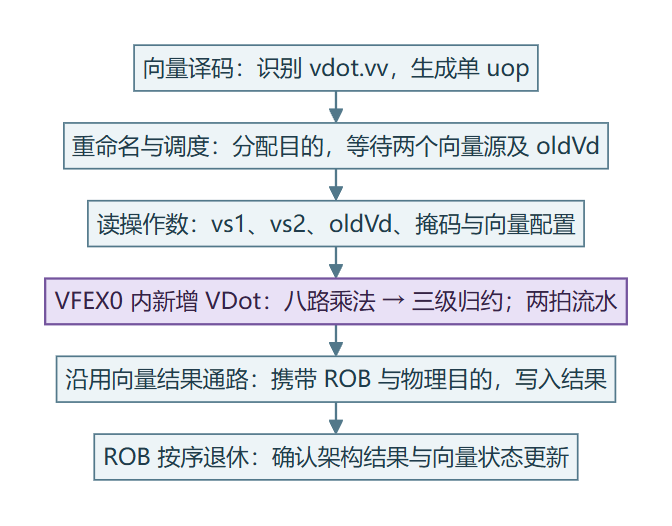
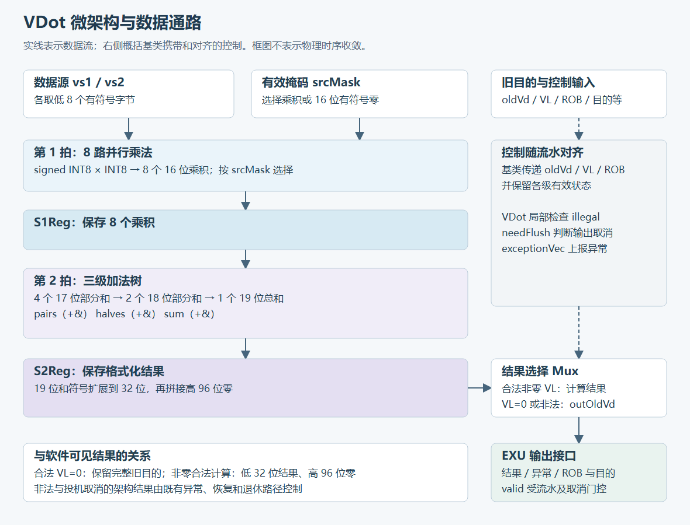

# 4 指令规格与微架构设计

vdot.vv 一次完成八路 signed INT8 乘积归约：低 32 位写精确和，高 96 位清零。标准 RVV 也能算到同一结果，但要拆成加宽乘、归约、配置切换和目的整理。我们把这条固定路径收进 VFEX0 里的专用两拍单元，寄存器依赖和精确异常仍走香山原有后端。

输入仍来自既有向量寄存器，结果仍由既有向量后端提交。这样我们可以单独研究算术融合带来的收益，同时保持处理器原有的依赖与精确异常机制。

本章对应赛题 2.1，说明软件可见行为、结构选择和数据流。各项设计的 Chisel 写法和后端注册方式集中放在第 5 章。

## 4.1 固定配置与 custom-0 编码

vdot.vv 使用 custom-0 机器码，在 SEW=8、LMUL=1、VLEN=128 的固定配置下工作，在本项目锁定版本的香山主译码表与 NEMU 顶层规则中，保存的静态检查未发现编码交叠。

设计基于香山昆明湖 V2 单核 MinimalConfig，VLEN=128，ROB 有 48 个槽位。赛题给定了三项要求：固定八项 signed INT8、归约初值为零、其余输出清零。在此基础上，我们进一步规定了结果写入哪些位、掩码怎样生效、VL 取哪些值合法，以及执行后状态怎样更新，形成下述实现规格。RTL 与参考模型共同遵守这份定义。

无掩码形式写为 `vdot.vv vd,vs2,vs1`，掩码形式追加 `v0.t`。当前工具链通过 `.word` 发出 custom-0 机器码。

表 4-1　指令编码

| 位段 | 字段 | 取值或含义 |
| --- | --- | --- |
| [31:26] | funct6 | `000000` |
| [25] | vm | 1：全部项参与；0：由旧 v0 的低八位使能 |
| [24:20] | vs2 | 第二向量源 |
| [19:15] | vs1 | 第一向量源 |
| [14:12] | funct3 | `000` |
| [11:7] | vd | 向量目的 |
| [6:0] | opcode | `0001011`，即 custom-0 `0x0b` |

识别条件为 `(word & 0xfc00707f) == 0x0000000b`。例如 `vdot.vv v3,v2,v1` 编码为 `0x0220818b`，相应的掩码形式为 `0x0020818b`。保存的编码检查枚举了 65,536 种寄存器及 vm 组合，在锁定版本的香山主译码表与 NEMU 顶层规则中均未发现交叠[〔1〕](../../evidence/records/docs/reviews/vdot-encoding-audit-2026-10-19.md.txt)。

## 4.2 按位掩码的八项求和与 128 位结果布局

指令对源低八项做按位掩码的有符号乘积求和，结果符号扩展后写入低 32 位，高 96 位清零。

最低字节是源元素 0。对 i=0…7，把两个源的第 i 个字节按 8 位补码解释为 aᵢ、bᵢ；掩码使能为 `mᵢ = vm OR old_v0[i]`。指令计算：

```text
S = Σ(i=0..7) mᵢ × aᵢ × bᵢ
vd[31:0]   = sign_extend_32(S)
vd[127:32] = 0
```

掩码按“位”选择参与归约的乘积。旧目的不参与求和。源寄存器高 64 位不参与运算；即使 VL=16，也只计算低八项。合法非零 VL 下，整个目的由本次结果定义：负数在低 32 位保留符号，高 96 位仍为零。

零掩码与 VL=0 是两种不同情况。零掩码是参与项为空的合法计算，结果全零；VL=0 则保留完整旧目的。这一区别要求硬件同时具备算术通路和 oldVd 保持通路。

表 4-2　配置和架构状态规定

| 主题 | 本实现规定 |
| --- | --- |
| 类型 | SEW=8、LMUL=1、VLEN=128；有效向量上下文，vill=0，vtype 保留高位为零 |
| 长度 | VL=0 保持目的；VL=8～16 固定计算八项；VL=1～7 非法 |
| 重启 | vstart=0；非零 vstart 触发非法指令异常 |
| 掩码及重叠 | 支持 vm=0/1；允许源/目的重叠及掩码形式 vd=v0，读取旧版本输入 |
| 尾部与掩码策略 | 合法非零运算固定生成完整结果，vta/vma 不改变目的布局 |
| 成功状态 | 保持 vl、vtype、vxrm、vxsat；vstart=0；相关 VS 置 Dirty，包括合法 VL=0 |
| 非法状态 | 进入平台精确异常机制，目的向量及相应向量控制状态保持；陷阱 CSR 按异常路径更新 |

合法性检查排在 VL=0 保持分支之前，空长度同样要满足权限、类型和重启条件。指令要求 vstart 为零：它不保存中途的部分和，若从中间某个元素重新开始累加，得不到与完整执行相同的结果。完整规格及约定来源见指令规格基线和机器可读参数[〔2〕](../../evidence/records/docs/vdot-spec-v0.1.md.txt)[〔3〕](../../specs/vdot-v0.1.json)。

## 4.3 接入 VFEX0 的两拍 VDot 单元

新增算术硬件集中在 VFEX0 内的 VDot 单元；译码与执行配置还需注册该指令，ROB 和 CSR 增加异常指令字传递。重命名、发射、唤醒、写回和按序退休机制复用香山原有的向量后端。

一条 vdot.vv 译成一个微操作，经向量重命名和发射队列进入 VFEX0 内新增的 VDot 单元。两个向量源、oldVd、掩码和 VL/类型信息由既有的源读取与唤醒机制提供。输出沿原有向量结果通路写入物理寄存器，最终由 ROB 按序退休。



图 4-1　VDot 接入位置。新增部分是专用点积功能单元，寄存器版本管理、依赖检查和退休仍由既有后端承担。

这样，新增设计只需负责固定的点积运算和必要的控制。一个微操作完成全部计算，省去了标准指令组合中的多次配置和分步运算；相应地，必须向后端明确声明三件事：依赖旧目的、需等待掩码就绪、出错时上报的异常信息。这些接口由后续的功能测试和波形测试分别验证。

## 4.4 八路并行乘法与 8→4→2→1 归约树

### 4.4.1 树形归约与流水切分

八个乘积并行生成，经三级加法树归约；乘积之后和最终结果之后各设一级寄存器，接口固定为两拍。

固定八项输入允许一次并行生成全部乘积。归约采用 8→4→2→1 的树形结构，组合加法深度为三级。与依次串接七次相加相比，树形归约减少了单条组合路径经过的加法级数。代价是要并行布置八个乘法器及配套寄存器。

第一拍完成字节提取、乘法和掩码筛选，第二拍完成加法树与结果格式化。乘法与归约由此分在不同的寄存器区间。实际握手波形验证了这一时序，见第 6 章。我们没有把这项结构分析换算成综合频率或面积收益。

### 4.4.2 19 位精确和的位宽推导

最终和需要 19 位有符号数；每级保留进位即可在全范围内保持精确，无需饱和或舍入。

signed INT8 的范围为 −128…127。单项乘积最小为 −16256，最大为 16384，16 位有符号数足够表示。八项最大和为 `8×16384=131072`，而 18 位有符号最大值是 131071，所以最终归约必须保留第 19 位。

表 4-3　逐级扩位与保存位置

| 级 | 并行数量 | 位宽变化 | 数据含义 |
| --- | --- | --- | --- |
| 乘法及掩码 | 8 | 8×8 → 16 位 | 每项精确乘积，屏蔽项为零，进入 S1 |
| 配对相加 | 4 | 16+16 → 17 位 | 两项部分和 |
| 四项相加 | 2 | 17+17 → 18 位 | 四项部分和 |
| 八项相加 | 1 | 18+18 → 19 位 | 完整精确和 |
| 格式化 | 1 | 19 → 32 → 128 位 | 符号扩展至 32 位，高 96 位补零，进入 S2 |

负边界 −130048 的低 32 位为 `0xfffe0400`，正边界 131072 为 `0x00020000`。两者的高 96 位均为零。

## 4.5 两拍数据流：以 36 和 16 为例

有掩码和无掩码走同一条硬件，区别只在进入 S1 之前的项选择。

第一段：输入被接受后，从两个源取低八个字节，做有符号乘法。vm=1 时保留全部乘积；vm=0 时，未使能的项替换为 16 位有符号零。八个筛选后的乘积存入 S1，后续归约树只需对普通有符号数做加法。

第二段：从 S1 读出乘积，依次得到四个配对和、两个四项和与一个八项和，再符号扩展、补零并存入 S2。oldVd 经单独的保持路径同步传递，与有效位、向量控制信息和 ROB 身份保持同拍，最后在末级选择输出点积结果或 oldVd。



图 4-2　两拍点积数据通路。S1 保存筛选后的乘积，S2 保存格式化结果；oldVd 用于合法 VL=0 的保持。

以 A=`[1,2,3,4,5,6,7,8]`、B=`[1,1,1,1,1,1,1,1]` 为例：无掩码时得到 36；掩码 `0x55` 使第 0、2、4、6 项参与，得到 16。

表 4-4　同一输入的逐级计算

| 位置 | vm=1 | vm=0，mask=0x55 |
| --- | --- | --- |
| 乘法后 | [1,2,3,4,5,6,7,8] | [1,2,3,4,5,6,7,8] |
| S1 | [1,2,3,4,5,6,7,8] | [1,0,3,0,5,0,7,0] |
| 17 位配对和 | [3,7,11,15] | [1,3,5,7] |
| 18 位四项和 | [10,26] | [4,12] |
| 19 位总和 | 36 | 16 |
| S2 低 32 位 | `0x00000024` | `0x00000010` |
| S2 高 96 位 | 0 | 0 |

## 4.6 VL=0 保持与精确状态更新

### 4.6.1 VL=0 用 oldVd 把旧值复制到新物理寄存器

VL=0 仍要读取 oldVd：重命名之后，“保持目的”意味着把旧物理寄存器的值复制到新物理寄存器。

在乱序后端中，逻辑目的已被重命名到新的物理寄存器。若 v3 原来位于 P10，新指令获得 P51，那么 VL=0 的“保持 v3”就是把 P10 的值传给 P51，退休后 v3 才仍是原内容。单纯关闭结果写使能，新物理版本不会自动继承旧数据。

为此，译码声明 oldVd 依赖，执行端等待旧值就绪，在合法 VL=0 时选择该值输出。这里 oldVd 只用于完整目的保持，不参与非零点积的累加。合法 VL=0 完成后仍将 VS 置 Dirty，这是我们确定的状态策略。

### 4.6.2 结果只在按序退休后成为架构状态

结果可以先写入物理寄存器，但只有按序退休后才成为架构状态；被较老分支取消的结果不会提交。

ROB flag/value、物理目的和控制信息随数据一起前进。末级流水有效、且未被较老 redirect 取消时，单元才给出有效输出。非法配置通过异常位交给精确异常机制。若较老分支在结果已物理写入之后才纠正路径，后端恢复会阻止这一错误路径结果成为已提交的架构状态。

验证也要分三层：算术检查确认结果数值，FU 握手确认两拍执行，ROB/CSR 观察确认取消和状态更新。源码中的落实方式见第 5 章，实际输入和波形检验见第 6 章。

## 4.7 扩展到更高 SEW / VLEN

当前实现固定为 SEW=8、VLEN=128、8×INT8→INT32。提高 SEW 会增加乘法器和加法器位宽；归约树深度由项数 n 决定，固定 n=8 时仍为三级，掩码仍为每项一位。VFEX0 接入、oldVd 保持和精确异常的设计方式可继续采用，但数据宽度、时序和后端接口须重新核对。以下比较扩大元素位宽与按段复制两种扩展方向；它们是尚未实现、未验证的设计设想。

**现在固定的部分**　VDot 在展开时用 `require(VLEN == 128 && cfg.destDataBits == 128)` 和 `require(latency == 2 && latdiff == 0)` 锁定参数。合法配置只接受 SEW=8、LMUL=1。指令只读源低 64 位中的八个 INT8，精确和为 19 位，写入低 32 位，高 96 位清零。

**随参数变化的部分**　设每个结果归约 n 项、元素宽度为 SEW，各部件按表 4-5 变化。以 INT16→INT64 为例，八项 INT16 正好占满 128 位源，乘积为 32 位，八项最大和为 8×2³⁰=2³³，需要 35 位有符号数。VL 的合法范围也要按 VLMAX=VLEN/SEW 重新规定。

表 4-5　参数化后各部件的变化（设计分析，无实测）

| 部件 | 一般形式 | 当前：SEW=8，n=8 | 示例：SEW=16，n=8 |
| --- | --- | --- | --- |
| 乘法器位宽 | SEW×SEW → 2·SEW 位 | 8×8 → 16 位 | 16×16 → 32 位 |
| 归约树深度 | 平衡二叉树至多 ⌈log₂n⌉ 级 | 3 级 | 3 级 |
| 精确和位宽 | 采用 2·SEW+⌈log₂n⌉ 位可安全容纳 | 19 位 | 35 位 |
| 结果放置 | 结果容器宽度由扩展规格约定，须容纳精确和且不超过目的宽度 | INT32 写 [31:0]，高 96 位清零 | 可选 INT64 写 [63:0]，高 64 位清零 |
| 源读取范围 | n·SEW 位 | 低 64 位 | 完整 128 位 |
| 掩码粒度 | 每项一位，屏蔽项替换为 2·SEW 位零 | old_v0 低 8 位，16 位零 | old_v0 低 8 位，32 位零 |

**可沿用的接口职责**　扩展方案仍可按流水化 FU 组织，两源、oldVd、掩码、VL 输入以及配置和掩码唤醒继续承担原有职责。是否能保持一个微操作、一次目的更新和两拍唤醒，需要核对更宽的数据通路、寄存器堆分片、写回端口及实际时序；仅修改 `destDataBits` 并不能证明整核已支持更大 VLEN。合法 VL=0 仍应保持完整旧目的，非法条件仍交给精确异常通路。若编码字段不变，ROB 中的 mtval 重建方法可复用；若另设编码，则需同步修改识别与重建逻辑。

**更大 VLEN 的方向：按 128 位段复制 8 路单元**　以 SEW=8、VLEN=256 为例，可考虑两份八路单元：段 k 读取本段低八项，结果写入本段低 32 位，本段高 96 位清零；段 k 第 i 项使用 v0 的第 16k+i 位作掩码。这会产生两个段结果，属于新的多结果扩展语义，不能直接视为当前“整条指令只计算低八项、其余位清零”的 v0.1 规格在更大 VLEN 上的等价实现。实现前还须定义各段与 VL 的关系、未激活段的保持或清零、编码或版本区分，并同步修改 RTL、NEMU 和测试。本节只分析该候选方向：

- 每段仍为三级加法树，算术层级不因段数增加；更宽的总线、扇出和布线仍可能影响时序，两拍和 `CertainLatency(2)` 需重新验证。若改为跨全部元素归约，项数每翻倍才增加一级加法，流水切分须结合时序结果选择。
- 每段算术可沿用八项求和与结果格式化的做法；第 6 章的检查器和第 7 章的参考模型需增加多段输出、VL 和掩码测试，当前通过记录仍只覆盖 VLEN=128。
- 需要跨段总和时，软件可再用一次标准归约合并各段结果。这部分开销需另行测量，本文不作估计。
