# 6 功能测试与补充时序验证

七个基础用例全部通过：正数、负数、正负极值、零掩码、VL=0 和 VL=16 均满足完整 128 位目的与状态要求。整核波形进一步表明，VDot 从 FU 输入到完成为两周期，结果按序退休；被较老分支取消的投机结果不会提交。

功能验证从正数、负数和边界用例展开，分别检查八项归约、补码运算，以及极值和特殊配置下的结果布局。各类用例都采用可手算的输入，并检查整个 128 位目的与相关状态。随后我们用整核波形观察通过功能检查的指令怎样执行、取消和退休。

本章前半部分对应赛题 2.3.1～2.3.3，后半部分为补充时序验证。异常矩阵、寄存器重叠及流水套件的整体差分结果在第 7 章汇总。

## 6.1 vdot-smoke：C 检查器逐字节判定 128 位目的

vdot-smoke 用 C 程序计算独立期望，逐字节比较全部 16 字节输出，并检查 VL、VS、vcsr 和 vstart；任一项失败即返回 1。

vdot-smoke 由 C 检查器与汇编包装组成。C 程序构造输入并计算独立期望；汇编装载源、掩码和旧目的，执行自定义机器码，捕获状态并存回完整结果。运行使用修复版单核 MinimalConfig、源码 NEMU 和固定 Flash，应用自检与 DiffTest 同时工作。

每个输入、旧目的和输出数组都按 16 字节对齐。旧目的填入 `0xa0…0xaf`，输出缓冲区填入 `0xee`；A、B 的高八字节分别填入 127、−128。这些非零初值用来检验旧值保持、输出是否真正写回，以及高半输入是否被误算。

汇编先以 e8/m1、VL=16 装载完整寄存器，再切到目标 VL。执行前把 VS 重设为 Initial，并令 vxrm=3、vxsat=1、vstart=0。目标指令执行后立即读取 VS 和 VL，之后才配置并存储完整 v3。这样，后续向量存储指令置起的 Dirty 不会被误记到目标指令名下。

C 检查器的核心判定如下，直接覆盖全部 16 字节：

```c
    for (unsigned i = 0; i < 16; ++i) {
      uint8_t expected = vl == 0 ? old[i] : i < 4 ? (uint32_t)sum >> (8*i) : 0;
      if (out[i] != expected) {
        printf("FAIL vdot case=%d byte=%d got=%x expected=%x\n",c,i,out[i],expected); return 1;
      }
    }
```

非零 VL 下，低四字节保存小端 32 位点积，其余十二字节必须为零；VL=0 则逐字节与 old 比较。程序还要求 VL 与请求一致、VS=Dirty、vcsr=7、vstart=0。任一检查失败立即返回 1，全部用例通过才输出 PASS。实际执行顺序见完整 C 源码与汇编包装[〔10〕](../../evidence/records/artifacts/vdot-integration-2026-10-24/delivery/payload/vdot-smoke/main.c)[〔11〕](../../evidence/records/artifacts/vdot-integration-2026-10-24/delivery/payload/vdot-smoke/vdot.S)。

## 6.2 正数点积 case0 / case3：得到 36 与 16

两个正数用例均通过：无掩码得 36，掩码 `0x55` 得 16，高 96 位均为零。

无掩码用例 case0 取 A=`[1,2,3,4,5,6,7,8]`、B=`[1,1,1,1,1,1,1,1]`，VL=8、vm=1。八项乘积分别为 1…8，总和为 36，完整目的应为：

```text
vd = 0x00000000_00000000_00000000_00000024
```

这个用例同时检查求和和高 96 位清零。旧目的预先为非零，只更新低位而漏掉高位也会失败。

case3 使用相同输入，改为 vm=0、mask=`0x55`。从最低位起只有 i=0、2、4、6 使能，期望变为 `1+3+5+7=16`，完整结果为 `0x00000000_00000000_00000000_00000010`。这个用例能区分按位掩码与错误的逐字节解释，并确认掩码作用于乘积本身。

表 6-1　正数测试的期望与记录

| 用例 | 输入与使能 | 期望点积 | 实测判定 |
| --- | --- | --- | --- |
| case0 | VL=8，vm=1，全部八项 | 36 | `sum=36 full128=OK VS=Dirty` |
| case3 | VL=8，vm=0，mask=0x55 | 16 | `sum=16 full128=OK VS=Dirty` |

## 6.3 负数点积 case2：−130048 只在低 32 位带符号

case2 通过，实测为 `sum=-130048 full128=OK VS=Dirty`：低 32 位为 `0xfffe0400`，高 96 位为零。

case2 的前八对输入均为 −128 与 127，单项乘积为 −16256，八项和为 −130048。若把 0x80 当作无符号 128，结果符号会出错；若归约位宽不足，也得不到精确结果。

19 位和符号扩展到低 32 位后为 `0xfffe0400`，再与高 96 位零拼接：

```text
S  = 8 × (−128) × 127 = −130048
vd = 0x00000000_00000000_00000000_fffe0400
低地址起的字节 = 00 04 fe ff 00 00 00 00 00 00 00 00 00 00 00 00
```

逐字节比较同时验证了低 32 位的符号和高位清零；把负数符号扩展到整个 128 位的实现同样无法通过。该用例也覆盖了本运算的负极值。

## 6.4 边界用例 case1/4/5/6：19 位和、零掩码、VL=0 与 VL=16

表 6-2 中的边界用例全部通过；连同 6.2、6.3，七个用例的完整结果与指定状态检查均通过，整核运行同时给出 DiffTest、GOOD TRAP 和退出码 0。

### 6.4.1 case1：131072 检验第 19 位

case1 取八对 −128×−128，得到 `8×16384=131072`，低 32 位为 `0x00020000`。该值恰比 18 位有符号上界多 1，直接检验归约树是否保留了第 19 位。正、负极值共同覆盖了精确和的两端。

### 6.4.2 case4 / case5：零掩码清零，VL=0 保持

case4 为 VL=8、vm=0、mask=0，全部乘积被屏蔽，归约结果及整个目的应为零。

case5 为合法 VL=0，目的应保留 a0 a1 … af 全部旧字节，高位在左时为 `0xafaeadac_abaaa9a8_a7a6a5a4_a3a2a1a0`。它检验 oldVd 依赖及保持路径。日志仍会打印预先计算的参考字段 `sum=36`，但实际验收走的是代码中的旧值比较分支，这个字段不能当作 VL=0 的输出数值。

### 6.4.3 case6：VL=16 仍只算低八项

case6 把 VL 设为 16，低八项与 case0 相同，高八对特意填入 127×−128。按固定八项规格，结果仍为 36；若误算高半部，会额外加入 −130048。该输入能识别“按 VL 把全部十六项归约”的错误实现。

表 6-2　边界用例及其完整目的要求

| 用例 | 检查对象 | 完整目的要求 | 实际结果 |
| --- | --- | --- | --- |
| case1 | 正极值、19 位和 | 低 32 位 `0x00020000`，高位零 | 通过 |
| case2 | 负极值、符号扩展 | 低 32 位 `0xfffe0400`，高位零 | 通过 |
| case4 | 零掩码 | 完整 128 位零 | 通过 |
| case5 | VL=0 | 完整旧目的保持 | 通过 |
| case6 | VL=16、高半部隔离 | 低 32 位 36，高位零 | 通过 |

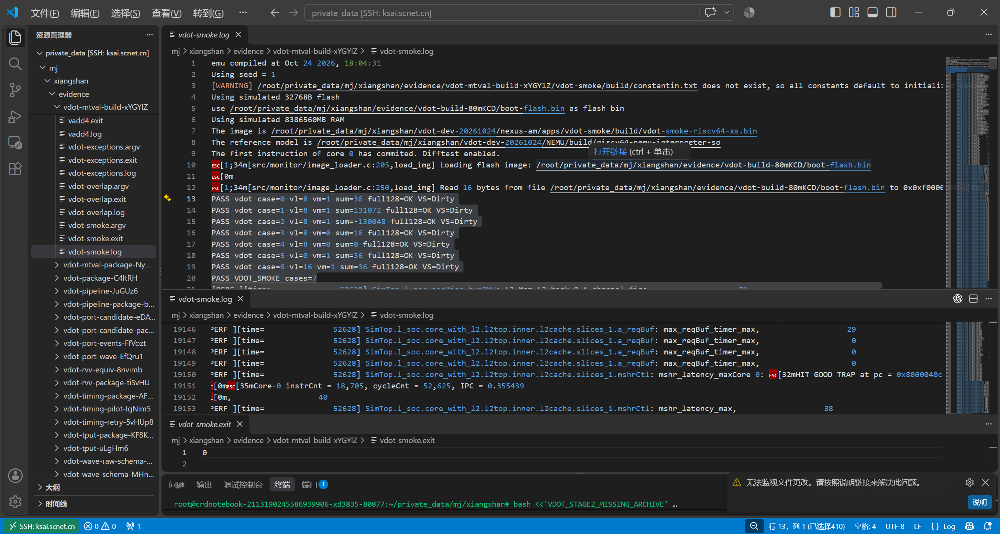

图 6-1　七例基础功能测试。正数、负数、极值、掩码及保持用例各自执行完整目的检查，原始记录见修复版整核回归[〔12〕](../../evidence/records/artifacts/vdot-mtval-fix-2026-10-24/server-xYGYlZ/review.json)。

## 6.5 正常实例：输入到 FU 完成 2 周期，到退休 26 周期

正常实例从 FU 输入到完成为 2 周期，从输入到退休为 26 周期。前者是功能单元的流水延迟，后者还包含后端按序提交的等待。

基础结果通过后，我们用整核 VCD 检查内部时序。各窗口的时钟周期均为 2 ps，握手按事件沿前的稳定值判定。实例用 PC、机器码、完整 ROB flag/value、pdest 和分配区间关联；正文中的 ROB/pdest 均为十进制。

正常实例 PC=`0x80000208`，机器码=`0x0220818b`，ROB=1/36，pdest=62。它在 14208 ps 分配，14220 ps 接受 FU 输入，14224 ps 输出完整结果，14272 ps 在 ROB 退休。

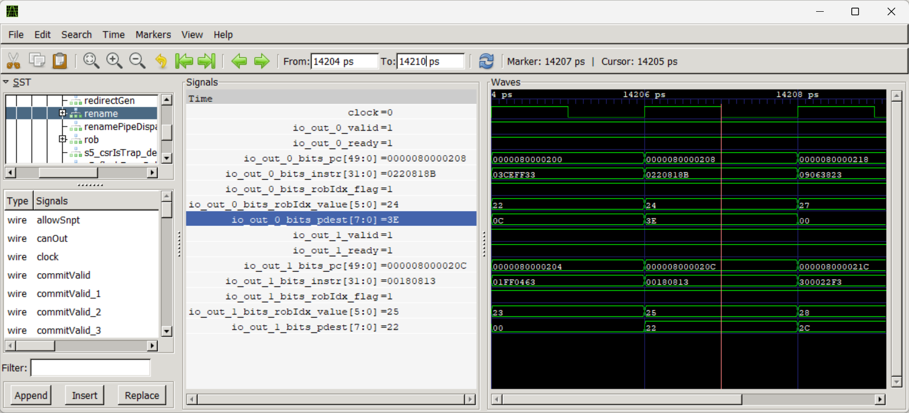

图 6-2　14207 ps 的分配沿前身份。波形中的 ROB 1/0x24、pdest 0x3e 对应正文的 1/36、62。

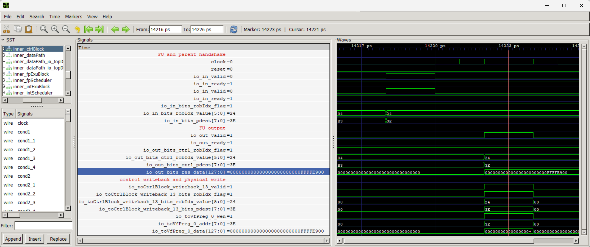

图 6-3　输入与输出相隔 4 ps，即 2 周期；输出为 `0x000000000000000000000000ffffe900`，低 32 位表示 −5888。

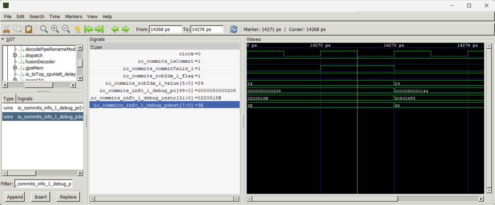

图 6-4　14271 ps 的 lane1 满足有效退休条件，ROB/pdest 与正常实例一致，对应 14272 ps 退休。

两个数字分别刻画功能单元流水和按序提交两段时间。原动态事件见正常与取消窗口核验[〔13〕](../../evidence/records/artifacts/vdot-window-supplement-2026-10-25/server-fgpWCe/review.json)。

## 6.6 取消实例：先完成的投机 VDot 未被提交

投机 VDot 在 16908 ps 已完成计算；较老分支在 16952 ps 发出 redirect 后，直到原 ROB 身份于 16970 ps 被复用，这条 VDot 都没有有效退休。

取消实例与正常实例 PC 和机器码相同，但属于另一条动态指令：ROB=1/27，pdest=61。较老分支位于 PC=`0x80000204`，ROB=1/26。VDot 在较老分支结果确定之前执行，因而可能先产生物理结果。

表 6-3　投机实例的事件顺序

| 事件 | 时间 | 相对 VDot 输入周期 |
| --- | --- | --- |
| 较老分支分配 | 16890 ps | −7 |
| VDot 分配 | 16892 ps | −6 |
| VDot 输入 | 16904 ps | 0 |
| VDot 完成 | 16908 ps | 2 |
| 分支 redirect，覆盖年轻 VDot | 16952 ps | 24 |
| 分支退休 | 16958 ps | 27 |
| VDot 原 ROB 身份复用 | 16970 ps | 33 |

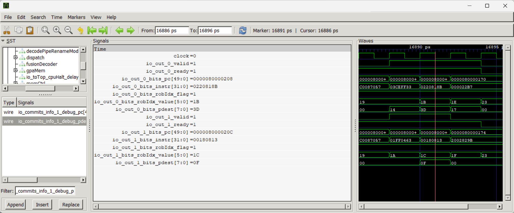

图 6-5　VDot ROB 1/0x1b、pdest 0x3d 在较老分支 ROB 1/0x1a 之后分配。

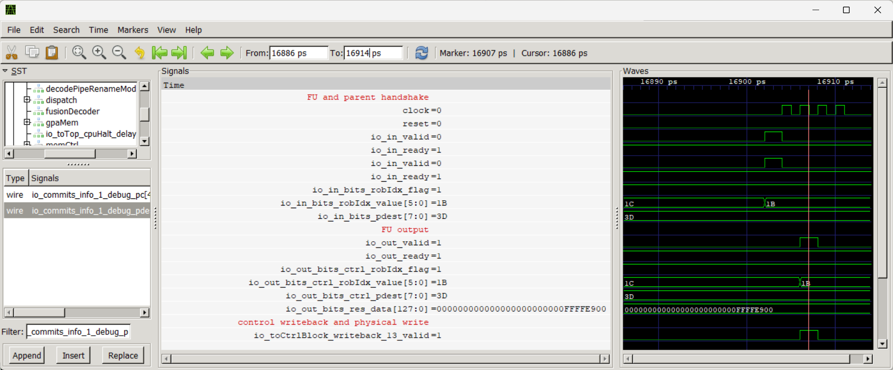

图 6-6　投机 VDot 在 16904、16908 ps 分别输入和完成，输出仍携带本次 ROB/pdest。

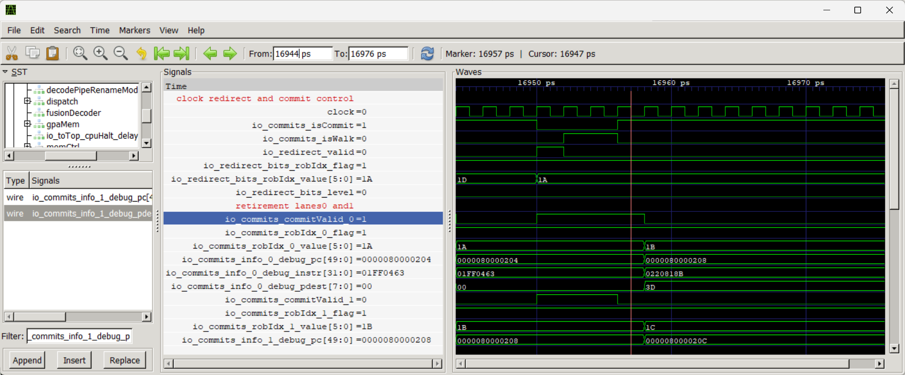

图 6-7　较老分支在 16952 ps 产生 redirect，随后退休；年轻 VDot 对应槽的身份数据没有形成有效退休。

FU 握手证明这条 VDot 已经算完；控制通知和物理端口观察补充了结果路径；ROB 则确认该投机结果没有提交。乱序执行允许先完成计算，架构状态仍由按序退休与分支恢复保护。

## 6.7 VS-dirty 请求与共享执行资源

VS-dirty 请求只来自有效退休贡献，2280 拍逐拍比较零差异。VDot 能与其他向量指令重叠推进；发射前端口竞争时，后者由仲裁延后两周期获准。

### 6.7.1 VS-dirty 只来自有效退休贡献

对保存窗口中的 2280 个非复位上升沿，我们逐拍比较 `isCommit AND OR(commitValid[i] AND dirtyVs[i])`、ROB 注册请求和 CSR 接收请求，结果零差异，其中八次正常 VDot 退休贡献均匹配。

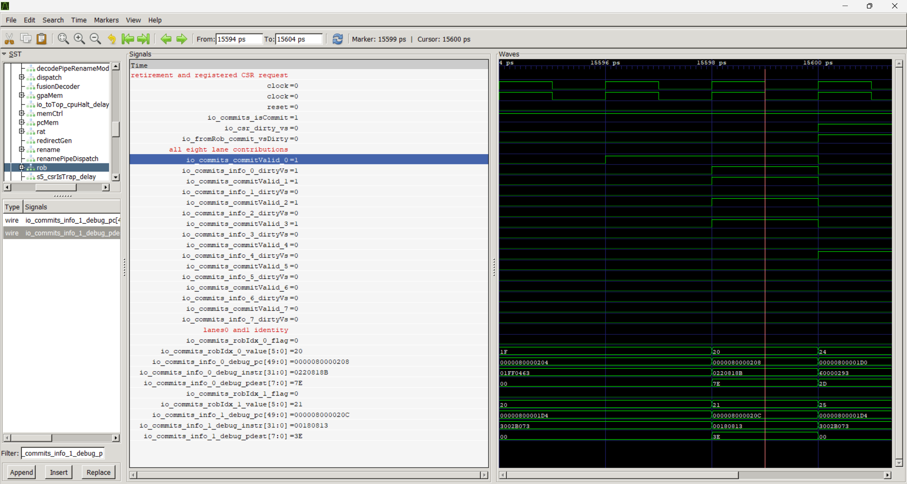

图 6-8　15599 ps 的 VDot 有效退休贡献在 15600 ps 沿后形成 ROB 与 CSR 请求。该例 ROB 为 0/32、pdest=126。

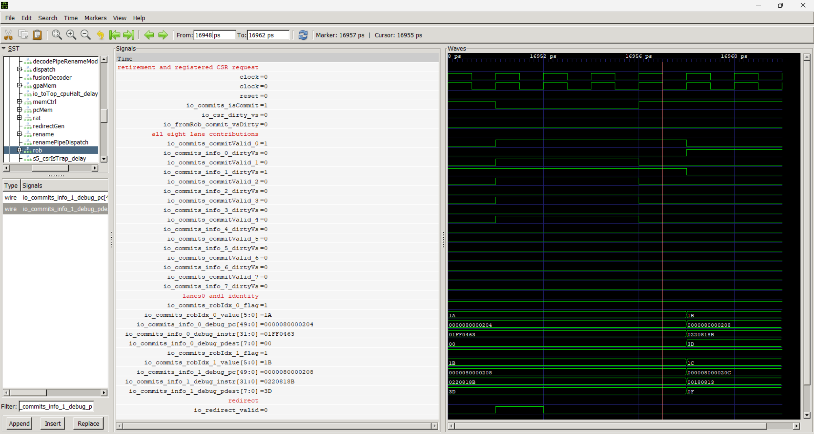

图 6-9　取消例中 VDot 槽虽然有 dirtyVs=1，但 commitValid=0，16958 ps 沿后请求保持为零。

两例说明，只有有效退休的槽才计入汇总，槽内残留的 dirtyVs 位不会单独触发请求。逐拍比较覆盖从退休槽标记到 CSR 接收请求的全过程；VS 寄存器有多个更新来源，它们同时出现时的优先级需另设用例检查。原记录见 CSR 请求核验[〔14〕](../../evidence/records/artifacts/vdot-csr-commit-window-2026-10-25/server-aReAEz/review.json)。

### 6.7.2 混发可重叠推进，端口竞争延后两周期获准

混发测试中，VADD 使用 EXU2，VMUL 和 VDot 使用 EXU0。三条指令的输入、完成和退休顺序如下：

表 6-4　混发实例，时间单位为 ps

| 指令 | ROB / pdest | 输入 | 完成 | 退休 |
| --- | --- | --- | --- | --- |
| VADD，PC=`0x800001b8` | 1/35 / 62 | 13216 | 13218 | 13222 |
| VMUL，PC=`0x800001bc` | 1/36 / 63 | 13218 | 13222 | 13226 |
| VDot，PC=`0x800001c0` | 1/37 / 64 | 13220 | 13224 | 13228 |

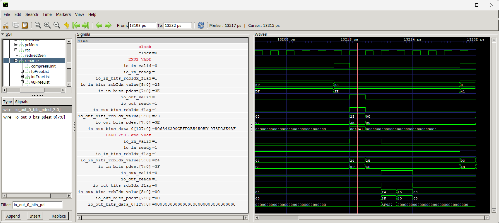

图 6-10　Marker=13217 ps 显示 VADD 输出与 VMUL 输入的有效条件，随后 VMUL、VDot 连续完成。

VMUL 与 VDot 的执行区间重叠，三者最终均退休，说明它们能在现有路径上交错推进。为进一步观察资源冲突，我们另构造了 VDot 与 VIOTA 共同申请发射前 VfWB 端口 0 的实例。

15658 ps 时两条请求同时有效：VDot（ROB=0/46，pdest=56）获准，VIOTA（ROB=0/47，pdest=57）的 ready 为零。VIOTA 于 15662 ps 再次申请并获准。两条指令随后分别在 15668、15672 ps 完成，在 15672、15676 ps 退休。

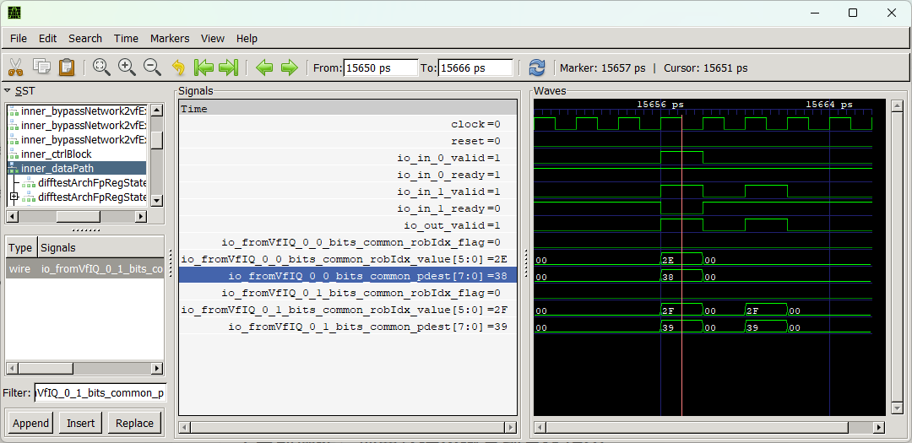

图 6-11　15658 ps 共同请求时，VDot 的 valid/ready 为 1/1，VIOTA 为 1/0，后者延后两周期获准。

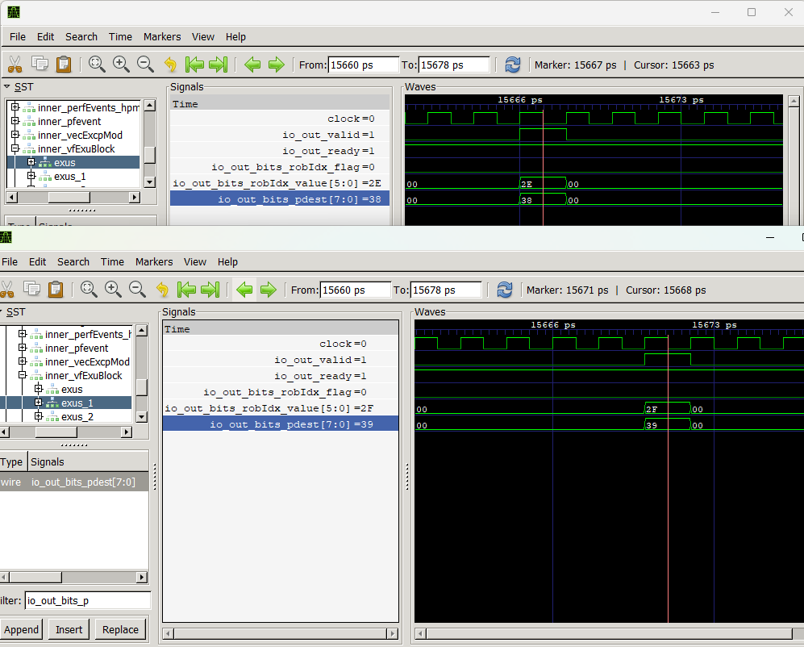

图 6-12　两条完成事件保持各自的 ROB/pdest，VDot 与 VIOTA 的结果在不同周期产生。

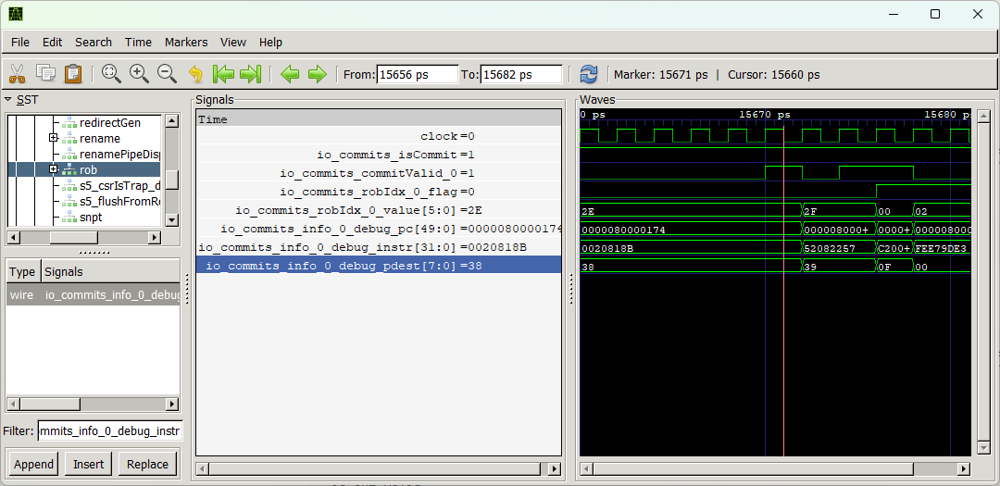

图 6-13　15671 ps 的 Marker 显示 VDot 退休沿前身份，后续时间窗显示 VIOTA 的退休身份。

两条指令的争用发生在发射前预约写回端口的阶段；该窗口中，真正写回结果时没有出现同一拍争用。本例验证了前端口仲裁及阻塞后的正常推进；写回同拍碰撞和更多 FU 组合留待后续用例。完整身份和采样记录见混发分析、端口事件与退休补图[〔15〕](../../evidence/records/artifacts/vdot-mixed-resources-2026-10-25/server-9k3waS/review.json)[〔16〕](../../evidence/records/artifacts/vdot-port-events-2026-10-25/server-FfVozt/review.json)[〔17〕](../../evidence/records/artifacts/vdot-gtk-review-2026-10-26/step3-retirement-instruction/review.json)。

基础测试确认了规定输入下的算术、布局与状态；补充波形把这些结果连接到真实的执行和提交事件。更大范围的异常、重叠与流水差分回归见第 7 章，那里还会用一个实际失配案例说明参考模型怎样帮助定位整核接入问题。
