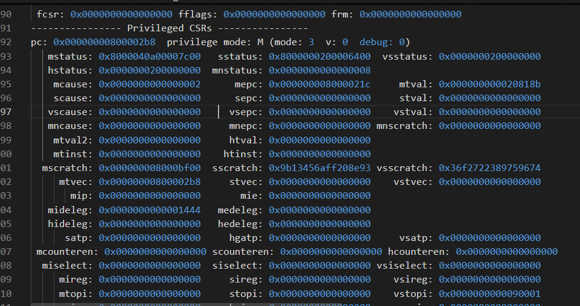
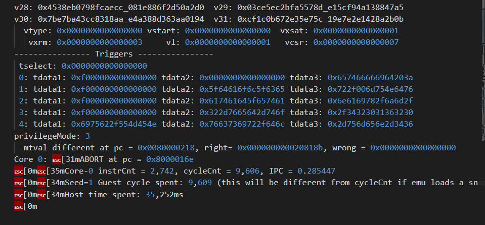
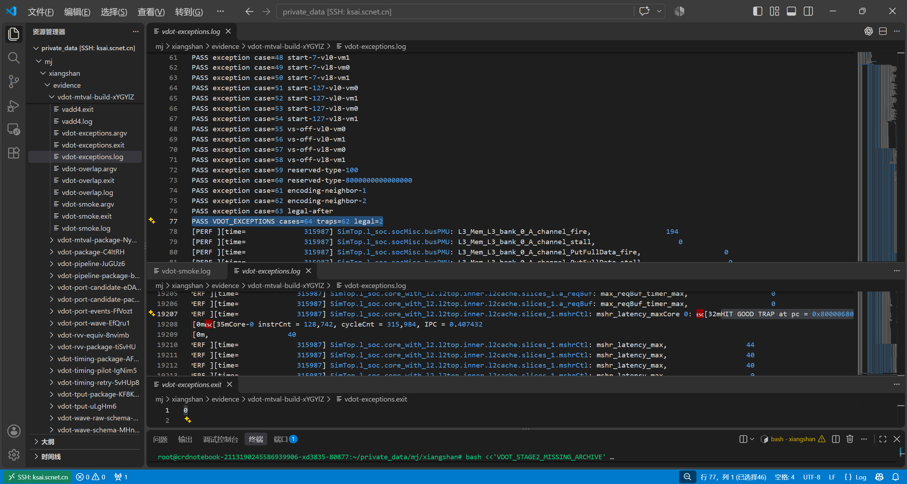
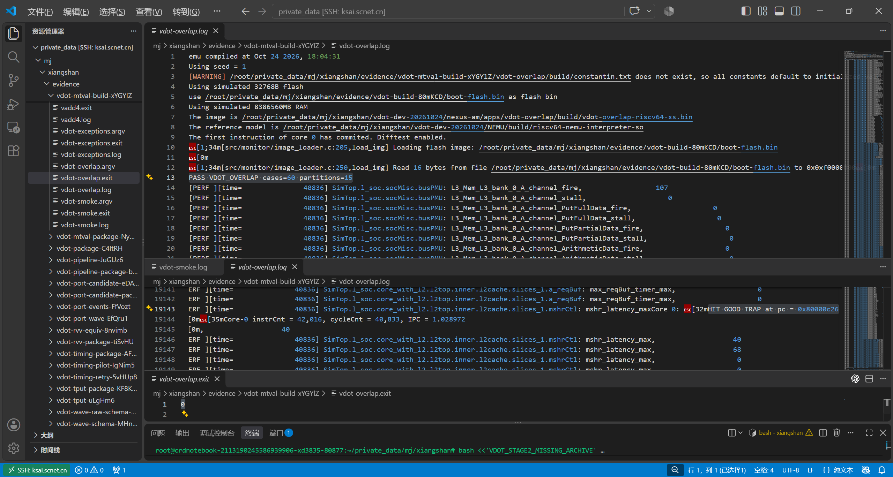
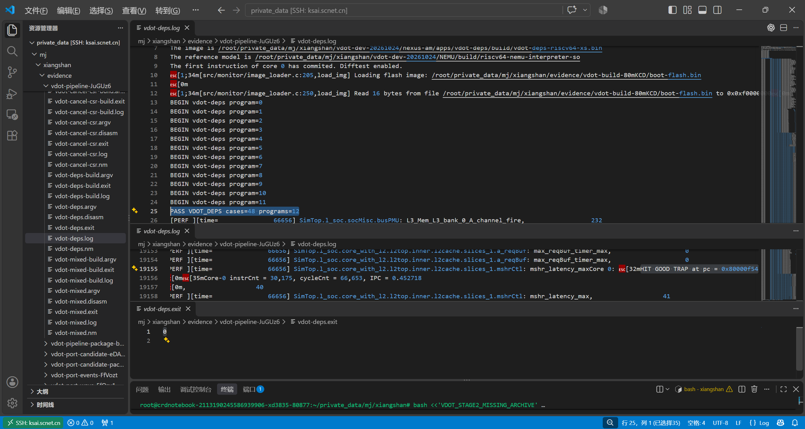
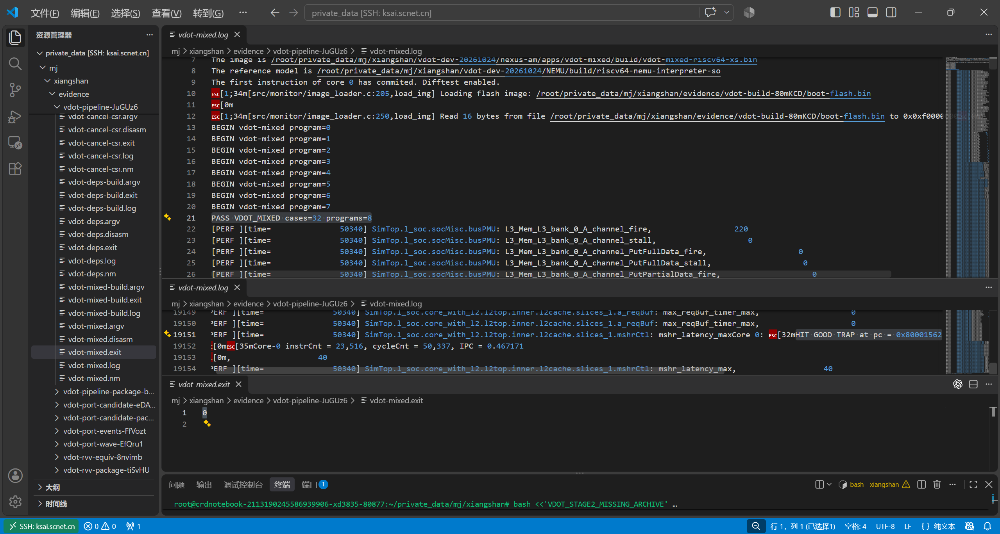
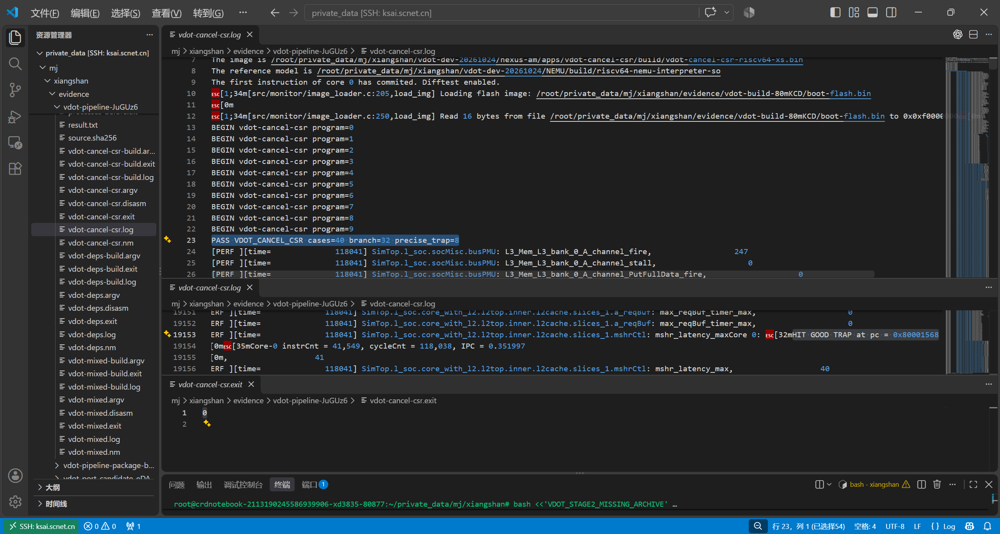

# 7 NEMU 扩展与差分验证

参考模型和整核差分全部通过：

- 参考模型 API 检查：268 例通过（另有 10 例配置不适用，单列，不计入通过数）。
- 修复版整核差分套件：SMOKE 7 例、EXCEPTION 64 例、OVERLAP 60 例、PIPELINE 120 例，全部通过。
- 回归中发现的短 VL 异常 mtval 失配已在 RTL 中修复，原异常用例回归通过，见 7.5。

自定义指令接入 RTL 后，参考模型也必须识别同一机器码、实现相同的架构语义。我们在源码 NEMU 中增加 vdot.vv，让测试应用、RTL 与 NEMU 在同一运行中互相校验：应用对照独立的数学期望，DiffTest 对照两侧的架构状态，波形解释内部事件。三个角度各有分工，只看最终数值容易漏掉异常或状态差异。

本章依次说明参考模型实现、验证范围和短 VL 异常中的 mtval 失配。这个案例展示了差分检查怎样从一个 CSR 寄存器值的差异出发，找到整核中漏传指令字的环节。

## 7.1 NEMU 与 RTL 共用 v0.1 指令规格

参考模型与 RTL 遵循同一份项目 v0.1 指令规格，合法配置范围和状态更新规则一致[〔1〕](../../evidence/records/docs/vdot-spec-v0.1.md.txt)。

在向量执行权限可用的前提下，合法配置要求 vill=0、SEW=8、LMUL=1、vstart=0，VL 为 0 或 8～16，vtype 保留高位为零。合法非零 VL 固定计算源低八项，精确和写入低 32 位、高 96 位清零；合法 VL=0 保持完整旧目的。类型、权限和重启条件的检查排在长度分支之前。

RTL 基于 XiangShan 16ae9ddc，叠加 VDot 和异常修复；参考模型基于 NEMU a48a11f2，叠加独立的语义实现。完整版本和二进制文件校验值见阶段三复现索引。

## 7.2 custom-0 译码规则与 def_EHelper(vdot)

NEMU 用一条 custom-0 译码规则生成 vdot 执行 ID，最终调用 `def_EHelper(vdot)`。

NEMU 修改分为四部分：译码入口、执行 ID 注册、向量计算头文件接入和新增语义文件。custom-0 的末七位为 `0001011`，funct6、funct3 均为零，其余字段保留 vm 与寄存器编号。实际译码规则为：

```c
#ifdef CONFIG_RVV
  def_INSTR_IDTAB("000000 ? ????? ????? 000 ????? 00010 11", OP_V  , vdot);
  def_INSTR_IDTAB("??????? ????? ????? ??? ????? 10101 ??", OP_V  , OP_V);
#endif // CONFIG_RVV
```

第一条规则识别 custom-0 位型并生成 vdot 执行 ID，第二条继续处理原有的标准 OP-V。执行 ID 注册到 isa-all-instr.h，vcompute.h 包含新增的 vdot.h，最终调用 `def_EHelper(vdot)`。机器码识别与计算语义由此有了明确的连接路径。

执行函数如下，摘自 vdot.h 源码[〔2〕](../../src/NEMU/src/isa/riscv64/instr/rvv/vdot.h)：

```c
def_EHelper(vdot) {
  require_vector(true); // host/guest VS and vill, before the vl=0 path
  if ((vtype->val >> 8) != 0 || vtype->vsew != 0 || vtype->vlmul != 0 ||
      vstart->val != 0 || (vl->val != 0 && (vl->val < 8 || vl->val > 16))) {
    longjmp_exception(EX_II);
  }
  const uint32_t word = s->isa.instr.val;
  const unsigned vd = (word >> 7) & 31;
  const unsigned vs1 = (word >> 15) & 31;
  const unsigned vs2 = (word >> 20) & 31;
  const unsigned vm = (word >> 25) & 1;
  if (vl->val != 0) {
    // Snapshot before any write, including vd=v0 and all source overlaps.
    const uint64_t a = cpu.vr[vs1]._64[0];
    const uint64_t b = cpu.vr[vs2]._64[0];
    const uint64_t mask = cpu.vr[0]._64[0];
    int32_t sum = 0;
    for (unsigned i = 0; i < 8; ++i) {
      const int ai = ((int)((a >> (8*i)) & 255) ^ 128) - 128;
      const int bi = ((int)((b >> (8*i)) & 255) ^ 128) - 128;
      if (vm || ((mask >> i) & 1)) sum += ai * bi;
    }
    cpu.vr[vd]._64[0] = (uint32_t)sum;
    cpu.vr[vd]._64[1] = 0;
  }
  vstart->val = 0;
  vp_set_dirty(); // includes legal vl=0 and guest VS when virtualized
}
```

实现中有三处与边界测试直接相关：

- 合法性检查位于 VL=0 之前，空操作也不能绕过异常条件。
- 两个源和掩码先存入局部变量，再改写目的；vd 与源或 v0 重叠时仍读取旧值。
- `(uint32_t)sum` 写入低 64 位容器时高 32 位为零，另一个 64 位字也置零，恰好形成低 32 位结果与高 96 位零。

合法 VL=0 跳过目的更新，但仍执行成功路径的状态处理；`vp_set_dirty()` 复用 NEMU 已有的向量状态机制。源文件及译码入口统一保存在 NEMU 修改快照中[〔3〕](../../src/NEMU)。

## 7.3 仿真器、参考库与测试镜像的构建和加载

协同仿真需要分别编译 RTL 仿真器 `emu`、NEMU 参考库 `riscv64-nemu-interpreter-so` 和 RISC-V 测试镜像。运行时，`emu` 加载测试镜像，通过 `--diff` 指定 NEMU 参考库，通过 `-F` 指定 Flash 镜像。


图 7-1　验证结构。应用对照独立期望值；DiffTest 在退休、异常等同步点比较 RTL 与 NEMU 导出的架构状态。

DiffTest 经 regcpy 交换状态。按本配置两侧的源码布局，交换区为 1400 字节；向量区从偏移 800 字节开始，32 个 128 位向量寄存器共 512 字节。参考库单步检查直接注入并回读这些状态，整核联合运行再检验实际的同步和执行行为。布局依据见接口核对记录[〔4〕](../../evidence/records/artifacts/scnet-abi-2026-10-24/abi-review.json)。

验收同时查看参考库路径、DiffTest 启用、应用 PASS、GOOD TRAP 和被测程序退出码；脚本及日志收集的退出状态单列记录。完整构建与运行命令入口见交付与复现记录[〔5〕](../../evidence/records/reports/stage3/delivery.md.txt)。

## 7.4 API 268 例与整核四类套件

API 层 268 例通过、10 例不适用单列；整核层 SMOKE、EXCEPTION、OVERLAP 和 PIPELINE 四类套件全部通过。

参考模型先经 API 接口做状态注入、单条执行和回读。检查覆盖完整的 32 个向量寄存器及相关 CSR，结果如下：

表 7-1　参考模型 API 检查

| 类别 | 数量 | 主要检查 |
| --- | --- | --- |
| 合法非零 VL | 93 | 目的结果及状态更新 |
| 合法 VL=0 | 40 | 完整旧目的保持及状态策略 |
| 非法配置 | 135 | 异常与相关状态保持 |
| 通过合计 | 268 | 上述三类 |
| 配置不适用 | 10 | 本参考库构建无法通过软件动态关闭 misa.V，单列 |

API 层使用的本地参考库与服务器参考库身份分别保存。十个不适用用例不计入通过数，原因在于参考库的 RVV 构建配置。每例记录见原始 API 结果[〔6〕](../../evidence/records/artifacts/vdot-integration-2026-10-24/nemu-api-151012/result.json)。

整核阶段再检查译码、执行、异常和退休的联合行为。表 7-2 统一列出定向套件；PIPELINE 小计为三项流水套件之和。

表 7-2　修复版整核差分套件

| 套件 | 用例数 | 目的 | 结果 |
| --- | --- | --- | --- |
| SMOKE | 7 | 正负数、极值、掩码、VL=0/16、完整目的与状态 | 通过 |
| EXCEPTION | 64 | 62 个预期陷阱、2 个合法对照；cause、mepc、mtval | 通过 |
| OVERLAP | 60 | 15 种源、目的、掩码相等关系 | 通过 |
| PIPELINE-DEPS | 48 | 12 个依赖测试程序 | 通过 |
| PIPELINE-MIXED | 32 | 8 个混发测试程序 | 通过 |
| PIPELINE-CANCEL-CSR | 40 | 32 个分支场景、8 个精确异常场景 | 通过 |
| PIPELINE 小计 | 120 | 上述三项流水套件 | 通过 |

这组回归覆盖表中的固定配置和场景；Hello 与 VADD 也在修复后同轮通过。等价和性能应用另外运行，各自报告调用数，调用数单独统计。原件见修复回归与流水回归[〔7〕](../../evidence/records/artifacts/vdot-mtval-fix-2026-10-24/server-xYGYlZ/review.json)[〔8〕](../../evidence/records/artifacts/vdot-pipeline-2026-10-24/server-JuGUz6/review.json)。

## 7.5 mtval 失配：现象、原因、改法与回归

早期 emu 在短 VL 异常上出现 mtval 失配，根因是执行期非法异常拿不到指令字。RTL 修复后，原异常用例回归，64 例 EXCEPTION 全部通过。下面按现象、原因、改法、回归四步说明。

### 7.5.1 现象：DUT 的 mtval 为零

早期 emu 执行短 VL 用例 short-1-vm0 时，短 VL 按规格触发非法指令异常，但 DiffTest 报告：

```text
mtval different at pc = 0x0080000218, right=0x0020818b, wrong=0
```

参考模型的 mtval 为故障机器码 `0x0020818b`，DUT 的 mtval 为零。结合反汇编和提交轨迹可以区分两个 PC：`0x80000218` 是前一条已提交的 `sd t0,40(s0)`，实际发生异常的 VDot 位于 `0x8000021c`。异常同步时，差分行保留最近的比较位置，`mepc=0x8000021c` 则精确记录了故障指令地址。



图 7-2　参考快照为 mcause=2、mepc=0x8000021c、mtval=0x0020818b。



图 7-3　DUT 的 mtval 为零，参考值为故障机器码，差分检查随后中止运行。

### 7.5.2 原因：执行期非法异常拿不到指令字

短 VL 的非法条件在执行期才产生，而原有 trapInstInfo 通路主要服务于译码期非法指令异常。问题不在八项乘加，而在故障指令走到 ROB 队首、进入精确异常位置时，DUT 没有提供匹配的编码。若只检查目的数值，或关闭这项 CSR 比较，这个集成问题就无法解释清楚。

### 7.5.3 改法：ROB 分配时保存可变编码字段和代际，队首重建指令字

RTL 在 ROB 分配时保存 VDot 的可变编码字段和代际，队首异常时重建指令字，再由 CSR 选择器优先接收。改法保留原有的异常仲裁和 NEMU 语义，只把缺失的信息接回既有通路。源码与字段容量见第 5 章 5.5。

### 7.5.4 回归：原异常用例 64 例 EXCEPTION 全部通过

修复生成新 emu 后，我们用原异常镜像与参考库配置回归：64 例 EXCEPTION 全部通过，随后 OVERLAP、SMOKE、Hello 与 VADD 也通过。原失败 emu 和日志保留用于追溯，成功结果对应修复后的仿真器版本。



图 7-4　修复后异常套件正常结束，应用 PASS、GOOD TRAP 和退出状态共同确认本次回归结果。

这个案例串起了“发现差异 → 定位故障指令 → 解释缺失信息 → 修改 RTL → 原用例回归”的完整过程。诊断与反汇编依据见差分诊断记录[〔9〕](../../evidence/records/artifacts/vdot-matrix-2026-10-24/server-OMcrpf/diagnosis.md.txt)，源码修改见修复说明[〔10〕](../../evidence/records/artifacts/vdot-mtval-fix-2026-10-24/README.md.txt)。

## 7.6 OVERLAP 与 PIPELINE 的运行记录

OVERLAP 与三项 PIPELINE 套件的原始运行记录均正常结束，与表 7-2 一一对应。

寄存器重叠检查确认“先读旧源、再写目的”的语义；流水套件检查依赖、混发、分支和精确异常的架构结果。内部动态时序由第 6 章的波形补充。



图 7-5　OVERLAP 套件通过，保留 DiffTest、GOOD TRAP 及退出记录。



图 7-6　PIPELINE-DEPS 的依赖程序汇总与正常结束记录。



图 7-7　PIPELINE-MIXED 检查选定混发场景的架构结果。



图 7-8　PIPELINE-CANCEL-CSR 分别记录分支和精确异常场景。

在这些记录支持的配置与场景内，参考模型与 RTL 的架构状态保持一致。下一步要建立标准 RVV 组合与自定义指令的等价关系，才能有意义地比较两者的执行成本。
