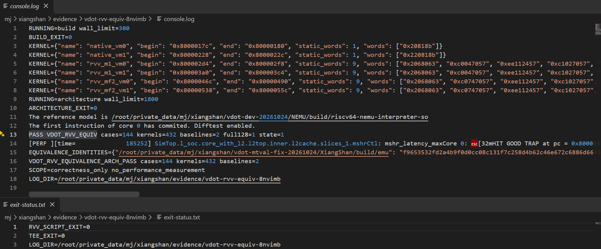

# 8 标准 RVV 等价基线

两条标准 RVV 基线 RVV-m1、RVV-mf2 与 VDot 在 144 种输入配置、共 432 次内核调用中，结果和指定状态完全一致；本地参考执行、完整 C 检查和服务器 RTL/NEMU 协同运行均通过。

比较延迟之前，先要保证三条路径做的是同一件事。点积的数学和相同还不够：目的高位、VL=0 保持和入口配置恢复同样影响调用者看到的结果。本章用标准 RVV 指令构造两条组合基线，明确各自的寄存器需求，并使用同一组测试用例验证完整结果和指定状态，对应赛题 3.2。

## 8.1 kernel_end 比较点与寄存器约定

三条路径在汇编 kernel_end 处比较，入口统一为合法 M 态、e8/m1、vstart=0，向量状态可用。

v0 保存掩码，v1/v2 保存源，v3 为目的；v8/v9/v16 和 t0 是允许破坏的临时寄存器。比较位置 kernel_end 位于测试壳再次配置和存储结果之前。

每条路径先与独立期望比较，再做路径间的状态比较。这样既能发现单条实现的错误，也能降低多条实现共享同一错误时漏检的可能。这套调用约定用于性能对比；源与目的寄存器任意重叠、非法配置等情况，由第 7 章的定向套件另行检查。

## 8.2 vwmul.vv 加 vwredsum.vs：两次加宽得到 INT32

标准 RVV 用 `vwmul.vv` 得到 INT16 乘积，再用 `vwredsum.vs` 加宽归约到 INT32；乘法分组不同，形成 RVV-m1 和 RVV-mf2 两条基线。

`vwmul.vv` 将 INT8×INT8 保存为 INT16 乘积，`vwredsum.vs` 将八项 INT16 加宽归约到 INT32。归约种子必须为零。目的 v3 先完整清零，再借尾部保持策略保留高位零，得到与自定义指令一致的低 32 位结果和高 96 位零。

两次运算需要不同的 SEW/LMUL 配置。有效输入只有八个字节，在 VLEN=128 下有两种合法组织：按 m1 乘法时，加宽目的使用 v8/v9 的 m2 组；按 mf2 乘法时，加宽目的恰好是单个 m1 的 v8。保留两条基线，可以观察寄存器分组怎样影响后续的执行成本。

表 8-1　两条基线的乘法与归约配置

| 基线 | 乘法配置 | 乘积存放 | 归约配置 |
| --- | --- | --- | --- |
| RVV-m1 | e8/m1，VL=8 | EMUL=2，v8/v9 | e16/m2，VL=8 |
| RVV-mf2 | e8/mf2，VL=8 | EMUL=1，v8 | e16/m1，VL=8 |

乘法生成完整的有符号乘积，掩码在归约时选择有效项。VL=0 跳过计算并保留旧目的，末尾恢复调用者的 vl/vtype。标准指令行为依据 RVV 1.0 规格，实际实现以本项目汇编为准[〔11〕](../../apps/vdot-rvv-equiv-v1/cases.S)。

## 8.3 三条核心段：1 条对 9 条静态指令

完成同样一次点积，VDot 核心段只需 1 条自定义指令，两条 RVV 基线的非零路径各需 9 条静态指令，程序明显更短；实际能快多少，要看第 9 章实测的周期数。

共同测试壳已装入源、掩码和入口配置，a3/a4 分别保存原 VL/vtype。下面列出 vm=0 的三个核心段。

VDot 由单条自定义指令完成：

```asm
    .word 0x0020818b
```

该字对应 `vdot.vv v3,v2,v1,v0.t`，操作数顺序为 vd、vs2、vs1。

RVV-m1 显式完成分支、配置、乘法、清零、归约和恢复：

```asm
    beqz a3,rvv_m1_vm0_restore
    vsetivli zero,8,e8,m1,tu,mu
    vwmul.vv v8,v1,v2
    vsetivli zero,4,e32,m1,tu,mu
    vmv.v.i v3,0
    vmv.v.i v16,0
    vsetivli zero,8,e16,m2,tu,mu
    vwredsum.vs v3,v8,v16,v0.t
rvv_m1_vm0_restore:
    vsetvl zero,a3,a4
```

RVV-mf2 改变乘法和归约的分组，其余职责相同：

```asm
    beqz a3,rvv_mf2_vm0_restore
    vsetivli zero,8,e8,mf2,tu,mu
    vwmul.vv v8,v1,v2
    vsetivli zero,4,e32,m1,tu,mu
    vmv.v.i v3,0
    vmv.v.i v16,0
    vsetivli zero,8,e16,m1,tu,mu
    vwredsum.vs v3,v8,v16,v0.t
rvv_mf2_vm0_restore:
    vsetvl zero,a3,a4
```

完整目的与种子在 e32/m1、VL=4 下清零；切换到归约配置后，tu 保留目的的高位零。末尾恢复原配置，基线不仅返回同一个和，也满足约定的调用状态。vm=1 内核在归约处省去 `v0.t`。

非零路径的九条静态指令包括一条长度分支、三次 vsetivli、一次乘法、两次清零、一次归约和一次恢复。九比一反映本文调用约定下需要写出的指令条数；执行时的依赖等待和配置开销在第 9 章实测。

## 8.4 等价验证用例：6 组数据、144 种配置、432 次调用

等价验证采用 6 组数据，组合出 144 种输入配置，三条实现共执行 432 次内核调用。C 检查器逐路径比较 v0～v3 共 64 字节，并能拒绝人为扰动的错误结果。

六组数据覆盖正数、混合符号、正负极值、零掩码和稀疏掩码。旧目的与源高半部填入非零值，用来识别错误清零、错误保持和高半输入污染。

表 8-2　测试数据与配置组合

| 维度 | 取值 |
| --- | --- |
| 数据集 | 6 组 |
| vm | 0、1 |
| VL | 0、8、16 |
| vta/vma | 4 种组合 |
| 输入配置数 | 6×2×3×4=144 |
| 每配置实现路径 | VDot、RVV-m1、RVV-mf2 |
| 内核调用总数 | 144×3=432 |

Python 整数模型产生独立期望。C 检查器逐路径比较完整的 v0～v3 共 64 字节，并检查约定的 CSR 状态：VL/vtype 恢复，VS=Dirty、vstart=0，vcsr/fflags 保持。源和掩码也在检查范围内，不允许只让 v3 的低位碰巧相同。

我们另对六个内核做了反汇编范围检查，确认标准路径使用加宽乘法与归约，且不含 custom-0 指令。负向检查主动扰动参考模型 RAM 中的期望字节，完整 C 检查器按预期返回 1，说明它能拒绝错误结果。

## 8.5 整核运行通过，GOOD TRAP 位于 0x80000858

服务器构建、运行、脚本及 tee 退出码均为 0，GOOD TRAP 位于 `0x80000858`；本地参考执行和完整 C 检查也全部通过。

应用独立构建后交给修复版 emu，显式加载源码 NEMU 和共同 Flash。服务器运行使用 seed=1，最大 300 万仿真周期、1800 秒墙钟上限；实际构建 3.726 秒，整核运行 680.930 秒。这些主机时间只用于安排复现，处理器周期另由计时内核读取。



图 8-1　两条 RVV 基线与 VDot 的等价验证通过。正常结束地址在完整日志中为 0x80000858，位于本截图右侧裁剪范围之外。

这组结果建立了固定调用约定下的比较基础。三条路径的结果和指定状态一致；RVV 基线中的配置、清零、归约种子和配置恢复，都是得到与 VDot 相同完整结果的必要步骤。第 9 章把它们纳入各自的计时窗口，先测依赖链延迟，再讨论配置复用和数据搬运改变后的性能。

本地结果、服务器核验、应用源码与实际构建运行入口均保留在配套工程中[〔12〕](../../evidence/records/artifacts/vdot-rvv-equivalence-2026-10-26/local-170237/result.json)[〔13〕](../../evidence/records/artifacts/vdot-rvv-equivalence-2026-10-26/server-8nvimb/review.json)[〔14〕](../../apps/vdot-rvv-equiv-v1)[〔15〕](../../evidence/records/artifacts/vdot-rvv-equivalence-2026-10-26/server-paste-command.txt)。
