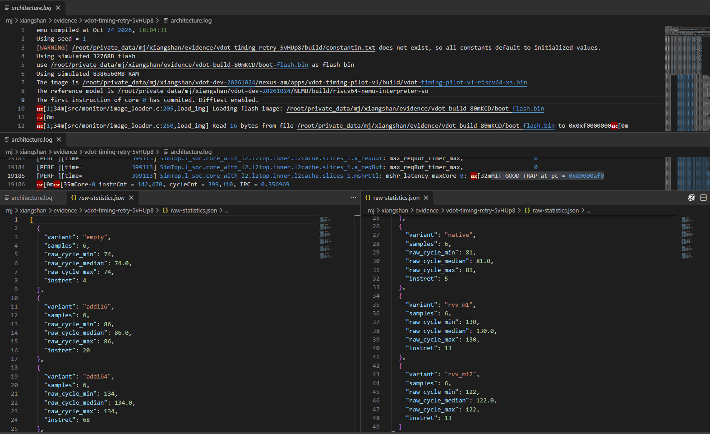
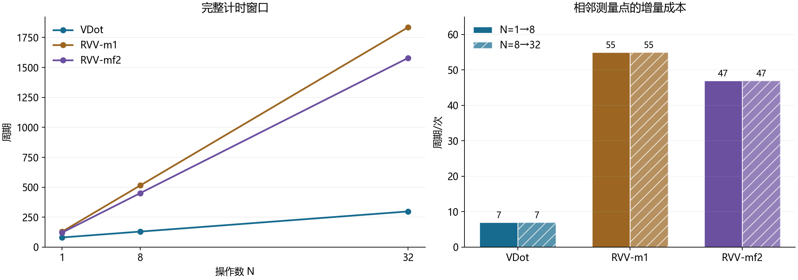
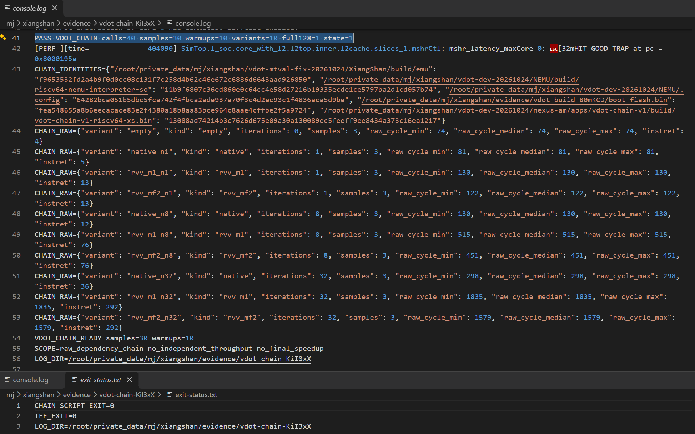
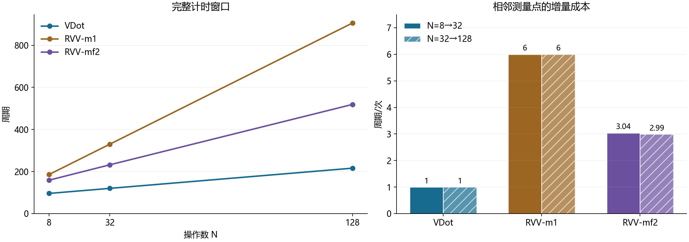
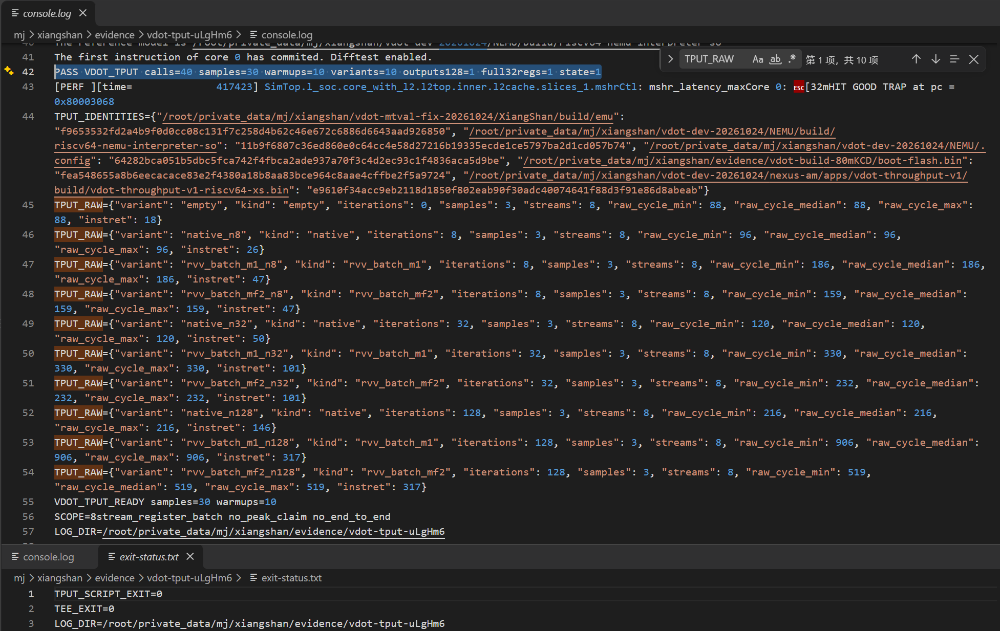
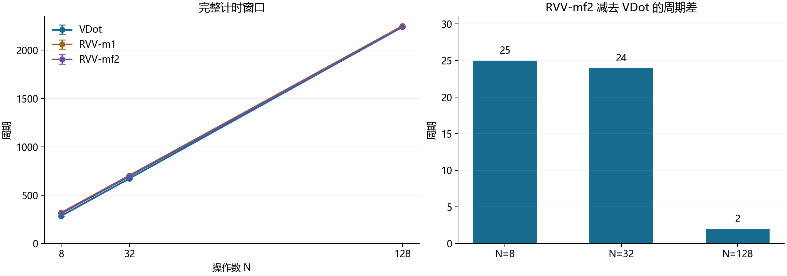
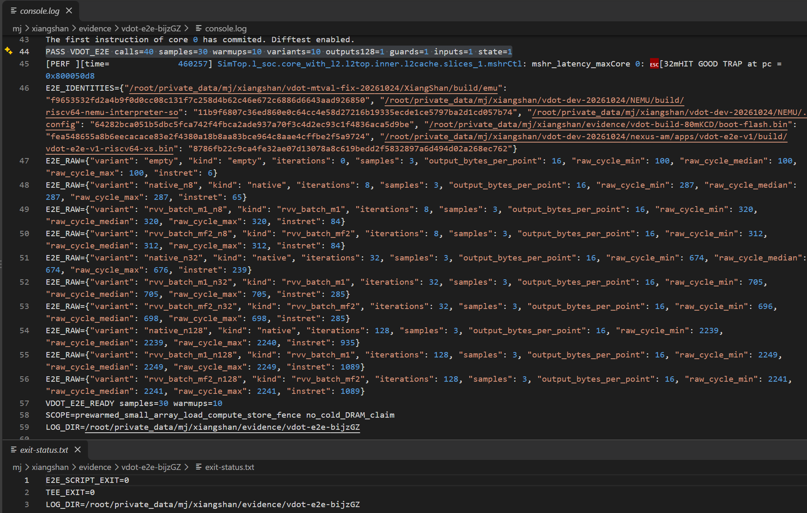
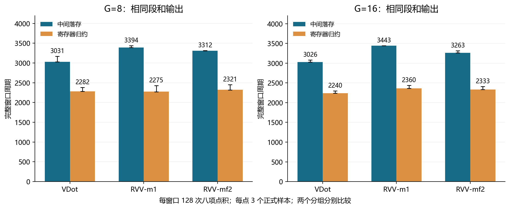
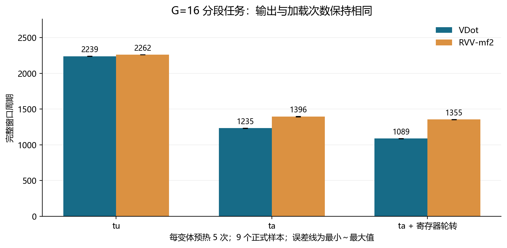
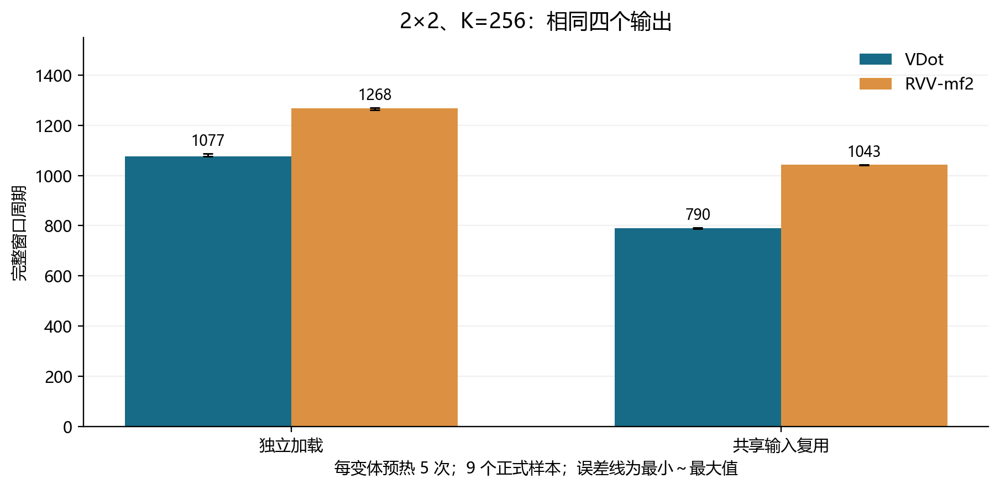

# 9 延迟测量与软件优化分析

在本章固定配置、寄存器输入和完整操作接口下，VDot 的依赖链增量延迟为 7 周期/次，RVV-m1 和 RVV-mf2 分别为 55、47 周期/次，对应延迟比 7.86、6.71。它们包含各实现维持相同接口所需的工作；含访存内核的整窗收益在后续实验中单独报告。

确认三条路径的结果一致后，我们先比较连续相关点积的执行速度：每次点积都使用前一次的结果，输入预先放在寄存器中，测量完整操作的依赖链延迟，对应赛题 3.3。随后测量八路操作的吞吐，再将加载和存储加入计时窗口，观察实际内核中的性能变化。

## 9.1 用依赖链增量斜率定义延迟

延迟取依赖链中“每多做一次完整操作所增加的周期数”，这样可以消去窗口的固定开销。

### 9.1.1 从单次耗时转向依赖链增量

直接包围一次操作读取计数器，得到的周期里还包含计时指令本身、读取计数器和使用结果等固定开销。空窗口为 74 周期，单次 VDot 窗口为 81 周期；若只比较这类短窗口的总周期，差异主要由固定开销决定，难以反映指令本身的成本。

主实验展开 N=1、8、32 次点积，每次读写 v1，后一次依赖前一次的结果。输入装载、最终存储和打印放在窗口外；RVV 路径每次仍执行完整的配置、清零和恢复。观察周期随操作数的增长，可以消去各路径的固定截距，得到串行依赖下每次完整操作的增量成本。

### 9.1.2 周期、延迟、吞吐和加速比

周期取自 RTL 仿真中处理器的 mcycle，退休指令数取自 minstret。服务器耗时是主机执行模拟器的时间，不能换算成被测指令的周期。记 N 次操作的正式样本周期中位数为 C(N)，对应的退休指令增量为 I(N)。

表 9-1　本章的指标定义

| 指标 | 定义 | 含义 |
| --- | --- | --- |
| 窗口周期 C(N) | 结束 mcycle − 开始 mcycle，单位为周期 | 完整计时窗口的执行周期 |
| 退休数 I(N) | 两次 minstret 读数之差，单位为条 | 计时窗口内退休的架构指令条数 |
| 增量成本 d | [C(N₂)−C(N₁)]/(N₂−N₁)，周期/次 | 每增加一次操作带来的周期增量 |
| 完整操作延迟 L | 真实依赖链中测得的 d | 串行依赖下每次完整操作的周期成本 |
| 延迟加速比 | L_RVV/L_VDot | RVV 与 VDot 的完整操作延迟之比 |
| 增量吞吐比 | 独立批处理中 d_RVV/d_VDot | 操作可重叠时，RVV 与 VDot 的平均周期成本之比 |
| 整窗比 | 同任务、同 N 的 C_RVV/C_VDot | 包含公共开销的同任务整窗周期比 |

加速比大于 1 表示 VDot 的周期成本更低。同一实现的软件优化另用“原组织周期/新组织周期”或耗时减少率 `1−C_新/C_原` 表达，不与 VDot 和 RVV 之间的加速比混用。周期中位数和最小～最大范围使用全部正式样本；范围反映本轮样本的波动。

### 9.1.3 预热与取样规则

预热指在正式统计前先调用相同内核，让代码与数据先被访问过，再观察重复调用的成本。预热能减小首次取指、数据访问及其他初始状态的影响，但不保证所有微架构状态都已进入稳态。

同一组的 VDot 和 RVV 变体采用相同的输入准备、预热次数、检查和采样规则，正式轮次轮换执行顺序。预热数据保留，但不进入正式统计。早期实验每变体预热一次，加载与复用补测增加到五次；每点正式样本数见表 9-2。

表 9-2　各实验的样本安排，预热与正式总数包含空对照

| 实验 | 变体数 | 每变体预热 | 每点正式样本 | 正式样本总数 |
| --- | --- | --- | --- | --- |
| 计时预检 | 6 | 1 | 6 | 36 |
| 依赖链 | 10 | 1 | 3 | 30 |
| 八路批处理 | 10 | 1 | 3 | 30 |
| 逐点输出小数组 | 10 | 1 | 3 | 30 |
| 分段点积两种组织 | 13 | 1 | 3 | 39 |
| 输入加载策略与轮转 | 7 | 5 | 9 | 63 |
| 2×2 输入复用 | 5 | 5 | 9 | 45 |

所有测量采用锁定的单核 MinimalConfig、VLEN=128、seed=1，复用同一修复版 emu、源码 NEMU 和 Flash。早期完整样本见归档逐轮表[〔16〕](../../evidence/records/artifacts/stage3-remote-archive-2026-10-27/server-MIwNSR/complete-samples.md.txt)，新增两组见补测结果[〔17〕](../../evidence/records/artifacts/vdot-load-reuse-2026-10-30/server-review.json)。

## 9.2 CSRRW 写 mscratch 作计时边界

计时边界采用写 mscratch 的 CSRRW，并在负载后消费结果；预检中每点六次正式样本周期一致，退休增量等于负载指令数加 4。

香山是乱序处理器。仅在负载前后放两条只读 CSR 指令，还需确认它们与负载的执行次序。锁定版本的香山允许部分只读 CSR 指令与前后指令乱序执行，所以我们改用写 mscratch 的 CSRRW 作边界，并在负载后消费运算结果，让结束读数依赖目标工作。

```text
外侧边界 → C0 → 边界 → I0 → 边界 → 负载 → 结果消费者
         → 边界 → I1 → 边界 → C1 → 外侧边界 → 保存与恢复
```

C0/C1 读取 mcycle，I0/I1 读取 minstret。预检用 `vmv.x.s` 消费 v3 结果并检查低字节，其他实验按各自的输出设置消费者。mscratch 的入口值保存在 t6，返回前恢复并检查。原始周期差包含四个内部写边界、两次退休计数读取和消费者，我们保留空对照来观察这部分共同成本。

该边界针对本版本微架构的调度行为建立，实际汇编见计时程序[〔18〕](../../apps/vdot-timing-pilot-v1/cases.S)。含存储的实验还在窗口末尾执行一次 `fence rw,rw` 和结果读回，把最终输出完成的成本纳入比较。

预检用空操作、整数指令序列和三条点积路径检查边界，结果见表 9-3。

表 9-3　计时预检结果

| 负载 | 负载指令数 | 窗口周期 | 退休增量 |
| --- | --- | --- | --- |
| empty | 0 | 74 | 4 |
| addi16 | 16 | 86 | 20 |
| addi64 | 64 | 134 | 68 |
| VDot | 1 | 81 | 5 |
| RVV-m1 | 9 | 130 | 13 |
| RVV-mf2 | 9 | 122 | 13 |



图 9-1　六组预检的周期与退休数，连同参考库、DiffTest 和正常结束信息。应用通过及退出状态保存在预检记录[〔19〕](../../evidence/records/artifacts/vdot-timing-pilot-2026-10-26/server-5vHUp8/review.json)。

## 9.3 依赖链延迟：7 对 55 / 47 周期

依赖链中 VDot 为 7 周期/次，RVV-m1、RVV-mf2 为 55、47 周期/次，延迟加速比为 7.86、6.71。

依赖链的每次点积都读写 v1，后一次必须等前一次的结果。窗口内包含 RVV 每次的配置、乘法、清零、归约和恢复，VDot 则用自定义指令完成规定操作。测量的是相同接口下完整操作的推进速度。表 9-4 列出三种长度的原始中位数；各点三个正式样本一致，两段长度扫描的斜率也相同。

表 9-4　依赖链周期和退休数，单元格为“周期 / 条”

| 路径 | N=1 | N=8 | N=32 | 1→8 增量 | 8→32 增量 |
| --- | --- | --- | --- | --- | --- |
| VDot | 81 / 5 | 130 / 12 | 298 / 36 | 7 周期/次 | 7 周期/次 |
| RVV-m1 | 130 / 13 | 515 / 76 | 1835 / 292 | 55 周期/次 | 55 周期/次 |
| RVV-mf2 | 122 / 13 | 451 / 76 | 1579 / 292 | 47 周期/次 | 47 周期/次 |

7 周期是完整操作在后端依赖、调度和执行路径上的增量成本；第 6 章波形中的 2 周期对应 FU 从输入到完成，前者覆盖整条后端路径，后者只计功能单元内部，两者测量范围不同，可互为补充。

以 8→32 为例，VDot 的增量为 (298−130)/24=7，RVV-mf2 为 (1579−451)/24=47。由此：

```text
相对 RVV-m1：55 / 7 = 7.86 倍
相对 RVV-mf2：47 / 7 = 6.71 倍
```

三个点分别满足 C_VDot(N)=74+7N、C_m1(N)=75+55N、C_mf2(N)=75+47N。RVV 的截距比空对照多 1 周期。用相邻点差分可以消去各自的固定截距，不必假定三条路径共享同一个截距。

N=32 的 RVV-mf2/VDot 整窗比为 1579/298=5.30，小于增量比 6.71，原因是窗口仍包含固定开销。



图 9-2　依赖链数据与斜率。VDot 两段均为 7 周期/次，两条 RVV 基线分别为 55、47 周期/次。



图 9-3　依赖链原始记录，包含周期、退休数、PASS 和退出状态。数据来源为原始统计[〔20〕](../../evidence/records/artifacts/vdot-chain-2026-10-26/server-KiI3xX/raw-statistics.json)。

这组依赖链数据用于赛题要求的 Latency 对比。在完整操作接口和固定配置下，VDot 连续执行相关点积所需的周期明显更少。源码、运行和样本见依赖链程序及运行记录[〔21〕](../../apps/vdot-chain-v1/cases.S)[〔22〕](../../evidence/records/artifacts/vdot-chain-2026-10-26/server-KiI3xX/review.json)。

## 9.4 八路批处理：VDot 增量 1 周期/次

减少结果回授并共享配置后，VDot 的增量成本为 1 周期/次，相对 RVV-m1、RVV-mf2 的增量吞吐比为 6 和 3。

实际计算不一定每次都等待上一结果。第二组实验固定 v1/v2 为输入，把结果轮转保存到 v24～v31，减少结果到输入的回授；RVV 每八次共享乘法和归约配置。窗口包含起始清零、结束恢复和八个结果的读取汇总；目的复用仍保留既有的 oldVd 依赖。

表 9-5　八路批处理周期和退休数，单元格为“周期 / 条”

| 路径 | N=8 | N=32 | N=128 | 8→32 增量 | 32→128 增量 |
| --- | --- | --- | --- | --- | --- |
| VDot | 96 / 26 | 120 / 50 | 216 / 146 | 1.00 | 1.00 |
| RVV-m1 | 186 / 47 | 330 / 101 | 906 / 317 | 6.00 | 6.00 |
| RVV-mf2 | 159 / 47 | 232 / 101 | 519 / 317 | 3.04 | 2.99 |

增量单位为周期/次，各点三个正式周期样本一致。VDot 满足 C(N)=88+N，RVV-m1 为 138+6N。RVV-mf2 在 8→128 的平均斜率为 (519−159)/120=3，中间测量点比两端连线高 1 周期。

N=128 的整窗比为 906/216=4.19、519/216=2.40。这些数字描述多次操作重叠执行后的平均成本，属于吞吐指标，不再计入单条依赖延迟的加速结论。



图 9-4　VDot 的增量为 1 周期/次；RVV-mf2 保留两段实际差分值。



图 9-5　八路批处理实测结果，对应原始统计[〔23〕](../../evidence/records/artifacts/vdot-throughput-2026-10-26/server-uLgHm6/raw-statistics.json)。

寄存器内的延迟和吞吐优势已经确立。下一步把输入从内存送入、把结果写回，看这些优势在更完整的软件窗口里还剩多少。

## 9.5 逐点输出小数组：N=128 时基本持平

加入加载、存储和排空后，N=128 时 VDot 与 RVV-mf2 基本持平，整窗比为 2241/2239=1.0009，算术优势被数据搬运稀释。

小数组内核每次点积读取两组各八字节输入，并保存完整的 16 字节输出。程序每算完八项就集中存储八个结果，在整个窗口末尾执行一次 fence 和末项读回；初始化、输出哨兵、自检和打印位于窗口外。窗口内同时包含地址计算、加载、配置、点积、存储和排空。

表 9-6　逐点输出小数组的实测成本。周期为中位数，括号为出现波动时的最小～最大值；每点三个正式样本

| 路径 | N | 周期 | 退休数 |
| --- | --- | --- | --- |
| VDot | 8 | 287 | 65 |
| VDot | 32 | 674（674～676） | 239 |
| VDot | 128 | 2239（2239～2240） | 935 |
| RVV-m1 | 8 | 320 | 84 |
| RVV-m1 | 32 | 705 | 285 |
| RVV-m1 | 128 | 2249 | 1089 |
| RVV-mf2 | 8 | 312 | 84 |
| RVV-mf2 | 32 | 698（696～698） | 285 |
| RVV-mf2 | 128 | 2241 | 1089 |

N=128 时，VDot 比 RVV-mf2 少退休 154 条指令，却只少 2 周期。VDot 的整窗平均成本约为 17.49 周期/次，明显高于寄存器批处理的增量成本。缩短算术序列并没有同比例缩短这个含数据搬运的窗口。



图 9-6　随着 N 增长，VDot 与 RVV-mf2 的周期差从 25、24 缩小到 2。



图 9-7　小数组原始统计及检查记录；完整数据见原始统计[〔24〕](../../evidence/records/artifacts/vdot-e2e-2026-10-27/server-bijzGZ/raw-statistics.json)。

全应用计数器指出了进一步检查的方向：加载和存储等待较多，Sbuffer 请求的有效次数与接受次数差异明显。

表 9-7　小数组应用全程计数，日志 time=460257

| 计数器 | 值 | 观察含义 |
| --- | --- | --- |
| ROB clock_cycle | 460258 | 整个应用的计数范围 |
| ROB commitInstr | 210343 | 整个应用退休量 |
| ROB waitLoadCycle | 182322 | 存在较多加载等待活动 |
| ROB waitStoreCycle | 161379 | 存在较多存储等待活动 |
| ROB waitFenCycle | 860 | 包含 fence 等待 |
| Sbuffer req_valid / req_fire | 31229 / 16772 | 请求与接受次数不同 |
| DCache req_valid / req_fire | 3910 / 3903 | 该接口请求和接受计数 |

计数覆盖预热、初始化、自检、打印和所有变体，各等待项也可能重叠。这些数据提示应继续检查数据搬运与排空；由于无法从中拆出单个内核的停顿比例，也不足以断定哪一种资源是主要瓶颈。原始字段见完整计数器路径[〔25〕](../../evidence/records/artifacts/stage3-closeout-2026-10-27/e2e-read/perf-context.json)。

据此我们设计了三个分别受控的同输出对照：对照A 在相同段和输出下减少中间搬运；对照B 固定分段任务，调整输入加载；对照C 在共享输入的 2×2 任务中减少加载次数。

## 9.6 对照A：分段归约省去中间落存

结果：省去中间落存后，VDot 在 G=8、G=16 中耗时分别减少 24.7%、26.0%；同为寄存器归约时，VDot 相对 RVV-mf2 的整窗比仅为 1.017、1.042。

新任务每窗口读取两组各 1024 字节输入，完成 128 次八项点积，每连续 G=8 或 G=16 次得到一个段和。两种组织产生相同的段和：一种直接在寄存器中归约；另一种先把所有点积结果存入 scratch，再读回归约。后者额外搬运 2048 字节写和 2048 字节读。

G=8 最终输出 16 个完整向量结果，G=16 输出八个。两种组织、三条实现各自比较；计时均包含加载、地址与循环控制、计算、归约、最终存储及末尾 fence/读回。

表 9-8　分段任务的相同输出对照。括号为正式周期范围，退休数按“寄存器 / 落存”列出

| G | 路径 | 寄存器归约周期 | 中间落存周期 | 退休数 |
| --- | --- | --- | --- | --- |
| 8 | VDot | 2282（2282～2383） | 3031（3030～3169） | 859 / 1388 |
| 8 | RVV-m1 | 2275（2273～2427） | 3394（3394～3440） | 1013 / 1542 |
| 8 | RVV-mf2 | 2321（2320～2454） | 3312（3312～3313） | 1013 / 1542 |
| 16 | VDot | 2240（2240～2296） | 3026（3026～3079） | 843 / 1372 |
| 16 | RVV-m1 | 2360（2359～2438） | 3443（3443～3444） | 997 / 1526 |
| 16 | RVV-mf2 | 2333（2333～2405） | 3263（3262～3312） | 997 / 1526 |

两条 RVV 路径省去落存后也有改善，说明减少中间搬运对三种实现都有效。因此，调整数据组织带来的收益应与 VDot 指令本身带来的收益分开计算。



图 9-8　G=8、G=16 分面展示，各面只比较相同段和输出。柱高为中位数，误差线为三个正式样本范围。

多数变体的首个正式样本仍偏高。例如 G=8 的 VDot 为 2383、2282、2282 周期，RVV-m1 为 2427、2273、2275。小幅的跨实现差异需要结合这一波动来读。原始样本与统计见分段核验[〔26〕](../../evidence/records/artifacts/vdot-segment-2026-10-29/server-Pw1wQ8/review.json)。

这项实验只需输出段和，因此可以在寄存器中直接归约，省去中间结果的写入和读回；9.5 则需要逐点保存结果。减少中间搬运后，每次点积仍需加载输入，接下来继续调整加载策略和指令安排。

## 9.7 对照B：调整输入策略和加载安排

结果：加载条数同为 256，ta_rr 组织使 VDot 从 2239 降到 1089 周期，耗时减少 51.4%；同组织下 VDot 相对 RVV-mf2 的整窗比为 1.24。

为检查输入端成本，我们固定 G=16 任务：每窗 128 次点积，最终输出八个段和，执行 256 条向量加载。共设三个组织：原 tu；仅改变输入尾部策略的 ta；在 ta 基础上用 v1/v2、v6/v7 两组寄存器轮转并提前加载的 ta_rr。两条实现接受相同的优化，VDot 自身的 oldVd 语义不变。

这组实验重新测量了 tu 对照，采用每变体五次预热、九次正式样本。历史 G=16 的 2240/2333 周期来自不同的程序上下文和较少的预热，本节的优化比全部使用本批数据。

表 9-9　同一 G=16 任务的加载对照，每种组织均为 256 条向量加载

| 组织 | 路径 | 周期中位数 | 最小～最大 | 退休数 |
| --- | --- | --- | --- | --- |
| tu | VDot | 2239 | 2238～2241 | 843 |
| tu | RVV-mf2 | 2262 | 2260～2262 | 997 |
| ta | VDot | 1235 | 1231～1236 | 843 |
| ta | RVV-mf2 | 1396 | 1392～1398 | 997 |
| ta_rr | VDot | 1089 | 1087～1090 | 843 |
| ta_rr | RVV-mf2 | 1355 | 1352～1357 | 997 |



图 9-9　同输出、同加载条数下，策略和安排改变后周期下降。误差线为九个正式样本范围。

RVV-mf2 从 2262 降到 1355 周期。两条路径各自的退休数保持不变。周期下降与减少旧值保持约束、调整加载顺序的设计动机一致：ta 不再要求保留输入寄存器尾部的旧值，寄存器轮转则允许提前安排下一组加载。现有数据确认这组软件变化有效，但尚未通过逐内核事件拆分依赖等待、调度和其他因素各自的贡献。

在同样的 ta_rr 组织下，VDot 相对 RVV-mf2 的整窗比为 1355/1089=1.24，耗时减少 19.6%。原始轮次、运行身份和检查见加载实验记录[〔27〕](../../evidence/records/artifacts/vdot-load-reuse-2026-10-30/load/server-L4TEPC/review.md.txt)。

## 9.8 对照C：2×2 小块复用输入

结果：复用输入把向量加载从 256 条减到 128 条，VDot 从 1077 降到 790 周期，减少 26.6%；同组织下 VDot 相对 RVV-mf2 的整窗比为 1.32。

对照B 没有减少加载条数。本组考察共享输入的多输出任务：计算 K=256 的 2×2 小块，四个输出分别累加 A0/B0、A0/B1、A1/B0、A1/B1 的点积。每轮处理八个元素，共 32 轮，即每窗 128 次八项点积，最终保存四个 128 位结果。

独立加载组织为每个点积重新装入两个输入，每轮八次加载。复用组织只加载 A0、A1、B0、B1 四个块，再计算四个点积，完整窗口的向量加载从 256 条减到 128 条。双方采用相同的 ta 策略和预先按列存放的 B 输入；布局准备位于计时窗口外。

表 9-10　同一四输出任务的输入复用比较，五次预热后取九个正式样本

| 组织 | 路径 | 周期中位数 | 最小～最大 | 退休数 | 向量加载数 |
| --- | --- | --- | --- | --- | --- |
| 独立加载 | VDot | 1077 | 1076～1087 | 950 | 256 |
| 独立加载 | RVV-mf2 | 1268 | 1262～1270 | 1115 | 256 |
| 复用加载 | VDot | 790 | 787～792 | 694 | 128 |
| 复用加载 | RVV-mf2 | 1043 | 1041～1044 | 859 | 128 |



图 9-10　相同四个输出下的复用收益。该图与分段任务分别比较，不连接为跨任务趋势线。

RVV-mf2 从 1268 降到 1043 周期，减少 17.7%。两条路径各少退休 256 条指令，包含向量加载及地址推进的减少。复用组织内，VDot 相对同样优化的 RVV-mf2 为 1043/790=1.32 倍整窗比，耗时减少 24.3%。

这组结果体现了共享输入的作用。适用范围为固定配置、固定种子和预热后的给定 2×2 内核，不包含矩阵转置或打包成本。完整样本见复用实验记录[〔28〕](../../evidence/records/artifacts/vdot-load-reuse-2026-10-30/tile/server-x9yIzN/review.md.txt)；完整输出、保护区、输入、指定状态及差分检查的核验见两组汇总[〔17〕](../../evidence/records/artifacts/vdot-load-reuse-2026-10-30/server-review.json)。

## 9.9 性能结论与适用条件

- **延迟**：完整操作依赖链中，VDot 为 7 周期/次，RVV-m1、RVV-mf2 为 55、47 周期/次，延迟加速比 7.86、6.71。八路批处理中 VDot 增量成本为 1 周期/次，增量吞吐比为 6、3；吞吐数字不作为延迟重复计分。
- **适用条件**：优势在寄存器内的依赖链和共享配置的批处理中最明显。加入访存后，逐点完整输出内核在 N=128 时基本持平；在另行定义的相同输出任务内，减少中间存储、调整输入策略与加载安排、复用共享输入都能降低成本，同组织跨实现比较分别为 1.24（G=16 加载轮转）和 1.32（2×2 复用）。应用侧既要缩短点积核心序列，也要避免不必要的中间存储，并结合有效输入范围安排加载与复用。
- **不主张的内容**：结果限于单核 MinimalConfig、VLEN=128、seed=1 和预热后的给定内核。完整应用、冷数据及其他处理器配置的收益需要相应实验，不能由某一个内核比值直接推定；2×2 结果不含矩阵转置或打包成本。
